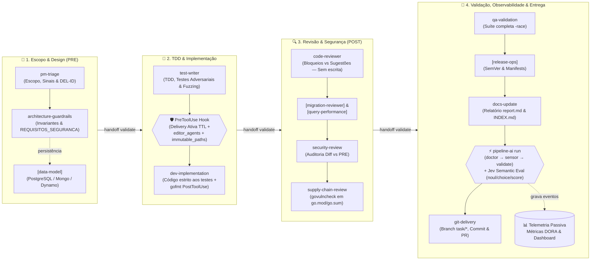

# pipeline-ai

[](LICENSE)
[](go.mod)
[](https://github.com/rodrigodosanjosoliveira/pipeline-ai/actions/workflows/ci.yml)

Toolkit e padrão reutilizável para projetos de desenvolvimento assistido por agentes de IA, integrando nativamente Go no backend e o ecossistema **Antigravity**.

A ferramenta central é a CLI unificada **`pipeline-ai`**, compilada estaticamente em Go puro sem dependências externas:

| Comando | Função |
|---|---|
| `pipeline-ai init` | Utilitário de *scaffolding* que inicializa novos projetos completos em 1 comando com templates embutidos, suporte a `-non-interactive` e `-json` (D-40). |
| `pipeline-ai run` | Pipeline Runner determinístico que executa em lote `doctor` → `sensor` → `validate` com auto-detecção de delivery, *Bounded Output* (`-max-output-bytes`, `-verbose-output`) e telemetria (D-27, D-39). |
| `pipeline-ai plugin` | Validador e instalador oficial do plugin do Antigravity (`verify`, `install`, `-json`) (DEL-023, D-40). |
| `pipeline-ai dashboard` | Gera dashboard HTML interativo e responsivo (Generative UI) com métricas DORA, esteira e entregas (DEL-022). |
| `pipeline-ai metrics` | Motor de telemetria e observabilidade com cálculo determinístico das quatro métricas DORA (`summary`, `list`, `-json`) (DEL-020). |
| `pipeline-ai handoff` | Parser e validador automatizado de contratos de transição entre skills (`validate`) com salvaguarda de Fuzzing (C12). |
| `pipeline-ai hook` | Hook `PreToolUse` que impede edição direta em caminhos protegidos fora dos agents/skills autorizados (D-11). |
| `pipeline-ai validate` | Valida o relatório de delivery antes do commit e abertura de PR, garantindo salvaguarda estrita de Git (D-14). Suporta flag `-json`. |
| `pipeline-ai sync` | Sincroniza e atualiza skills (`.agents/skills`), regras e hooks em projetos existentes sem tocar em código de negócio (`-json`) (D-40). |
| `pipeline-ai delivery` | Gerencia o ciclo da delivery ativa (`open`, `close`, `status`, `-json`), com suporte a TTL e governança temporal (D-21, D-40). |
| `pipeline-ai sensor` | Executa sensores de qualidade (`fmt`, `vet`, `test`) com saída estruturada, *Bounded Output*, *Smart Test Filtering*, marcação de resultados parciais (`truncated`, `omitted_bytes`, `failed_tests`) e salvaguarda contra falsos positivos (`-json`, `-max-output-bytes`, `-verbose-output`) (D-24, D-39). |
| `pipeline-ai module` | Gerencia módulos opcionais (`list`, `enable`, `disable`, `-json`) dinamicamente no `.pipeline-ai.json` (D-25, D-40). |
| `pipeline-ai doctor` | Diagnostica a integridade do ambiente local (Go 1.24+, git, gh, pre-push hook e `.pipeline-ai.json`). Suporta `--json` para automações e CI. |
| `pipeline-ai debt` | Lista e audita o inventário determinístico de atalhos deliberados (`// shortcut: <limite> \| upgrade: <gatilho>`) no código Go (`-dir`, `-json`) (D-38). |
| `pipeline-ai eval` | Submete avaliação semântica calibrada (System One / Jev) nos modos `noul`, `choice` e `score` ou via `-preset yagni` (D-34, D-35, D-38). |
| `pipeline-ai version` | Exibe a versão instalada da CLI em formato texto ou estruturado (`-json`) (D-40). |
| `pipeline-ai mcp` | Servidor MCP nativo (JSON-RPC 2.0 sobre stdio) expondo ferramentas de governança para Antigravity e IDEs. |

> [!TIP]
> **Dual-Audience CLI & Agent Mode (D-40):** A CLI opera nativamente para humanos e agentes de IA. Ao passar a flag `-agent` ou definir `PIPELINE_AGENT_MODE=1` (ou `AI_AGENT=1`), a CLI ativa automaticamente o modo estritamente não-interativo e saída estruturada JSON em 100% dos subcomandos (`version`, `delivery status`, `module list`, `plugin verify/install`, `sync`, `init`, `run`, `sensor`, `doctor`, `validate`, `handoff`, `debt`, `eval`, `metrics`). Comportamentos bloqueantes em `stdin` são prevenidos via detecção de terminal (`isTTY`).

*(Os binários individuais `pipeline-hook`, `pipeline-validate` e `pipeline-init` permanecem disponíveis para retrocompatibilidade com diretivas `tool` existentes).*

---

## Fluxo de Execução



---

## Estado

- Compilado e testado com **100% de sucesso em Go 1.24+** (stdlib pura, compatível com detector de concorrência `-race`).
- Integrado nativamente ao ecossistema **Antigravity** via `.agents/hooks.json`, regras e **16 skills modulares**.
- Automação via **`Taskfile.yml`** e workflow completo no **GitHub Actions** (`.github/workflows/ci.yml`).
- Versão estável atual: **`v0.11.0`**.

---

## Como Criar um Novo Projeto (1 Comando)

Crie o diretório do novo projeto e execute o `pipeline-ai init` (ou `pipeline-init`) via `go run`:

```bash
mkdir ~/workspace/meu-novo-app && cd ~/workspace/meu-novo-app

go run github.com/rodrigodosanjosoliveira/pipeline-ai/cmd/pipeline-ai@latest init
```

O utilitário guia você de forma interativa (ou via flags `-name`, `-type`, `-db`, `-module`, `-dir`, `-non-interactive`, `-json`) e entrega o projeto pronto:
- `git init` e hook `.githooks/pre-push` instalados (bloqueando pushes diretos na `main`).
- `go.mod` inicializado com diretivas `tool` apontando para a versão estável do `pipeline-ai`.
- `.agents/` configurado com `hooks.json`, regras e as 16 skills do padrão.
- `AGENTS.md` e `GEMINI.md` com placeholders substituídos.
- Estrutura completa de documentação e relatórios em `docs-ai/`.

Para esteiras de CI e agentes de IA autônomos, utilize o modo não-interativo com saída JSON estruturada:

```bash
pipeline-ai init -name meu-novo-app -type desktop -db postgres -non-interactive -json
```

Consulte o [Guia de Criação de Projetos](docs-ai/GUIA-CRIACAO-PROJETOS.md) para detalhes.

---

## Instalação em Projeto Existente

Requer Go 1.24 ou superior (a diretiva `tool` no `go.mod` é obrigatória):

```bash
go get -tool github.com/rodrigodosanjosoliveira/pipeline-ai/cmd/pipeline-ai@v0.11.0
```

*(Os comandos legados `cmd/pipeline-hook@v0.11.0` e `cmd/pipeline-validate@v0.11.0` também permanecem disponíveis).*

*(Se o repositório for privado, configure `go env -w GOPRIVATE="github.com/rodrigodosanjosoliveira/*"` e autentique o Git via SSH)*.

---

## Catálogo de Skills Nativas (16 Skills)

O fluxo do Antigravity é orquestrado por skills especializadas em `.agents/skills/`:

### Núcleo Obrigatório (10)
| Skill | Responsabilidade | Roteamento |
|---|---|---|
| `pm-triage` | Ponto de entrada de toda demanda. Classifica escopo, atribui `DEL-NNN` e roteia. | `architecture-guardrails` |
| `architecture-guardrails` | Define a abordagem técnica, limites de implementação, bloqueia violação de invariantes e emite `REQUISITOS_SEGURANCA` no PRE quando `SECURITY: sim` (D-22). | `data-model` ou `test-writer` |
| `test-writer` | Escreve os testes antes da implementação (TDD), testes adversariais de segurança e alvos de fuzzing determinísticos. | `dev-implementation` |
| `dev-implementation` | Implementa o código estritamente dentro do escopo até os 4 gates passarem. | `code-reviewer` |
| `code-reviewer` | Revisa o diff contra os invariantes e escopo. Não possui permissão de edição direta (D-04). | `migration-reviewer` / `query-performance` / `security-review` / `qa-validation` |
| `security-review` | Audita o diff pós-implementação contra os `REQUISITOS_SEGURANCA` definidos no PRE (D-22) e superfícies sensíveis. | `supply-chain-review` ou `qa-validation` |
| `supply-chain-review` | Audita alterações em `go.mod` e `go.sum` com `govulncheck` e `go mod verify`. | `qa-validation` |
| `qa-validation` | Valida o comportamento entregue contra o escopo inicial com suíte completa de testes (`-race`). | `release-ops` ou `docs-update` |
| `docs-update` | Atualiza documentação afetada e monta o relatório em `docs-ai/deliveries/`. | `git-delivery` |
| `git-delivery` | Cria a branch `task/*`, o commit padronizado e abre o Pull Request (`gh pr create`). | Encerramento |

### Módulos Opcionais (6)
| Skill | Ativação | Responsabilidade |
|---|---|---|
| `release-ops` | `"release-ops"` | Versionamento SemVer, checklist de manifests e notas de release. |
| `data-model` | `"data-model"` | Modelagem de dados para PostgreSQL (SQL), MongoDB (BSON) ou DynamoDB (PK/SK). |
| `migration-reviewer` | `"migration-reviewer"` | Auditoria de scripts DDL em `migrations/` (idempotência, rollback, zero-downtime). |
| `query-performance` | `"query-performance"` | Análise de planos de execução (`EXPLAIN`), índices adequados e eliminação de N+1. |
| `context-loader` | `"context-loader"` | Carregamento seletivo de documentações externas e contratos de API sob demanda. |
| `agent-auditor` | `"agent-auditor"` | Auditoria de integridade contra alucinação, drift e scope creep. |

---

## Configuração (`.pipeline-ai.json`)

Exemplo de configuração para projeto desktop (`examples/desktop/.pipeline-ai.json`):

```json
{
  "version": 1,
  "project_type": "desktop",
  "protected_paths": [
    "internal/",
    "frontend/src/",
    "main.go",
    "go.mod",
    "go.sum",
    "Taskfile.yml"
  ],
  "editor_agents": [
    "dev-implementation",
    "test-writer",
    "docs-update"
  ],
  "enabled_modules": [
    "release-ops",
    "data-model"
  ],
  "security_surface_paths": [
    "internal/auth/",
    "internal/crypto/",
    "internal/storage/",
    "go.mod",
    "go.sum",
    "build/",
    ".github/workflows/"
  ],
  "deliveries_dir": "docs-ai/deliveries",
  "index_file": "docs-ai/deliveries/INDEX.md",
  "base_ref": "origin/main"
}
```

---

## Automação e Gates (`Taskfile.yml`)

O repositório inclui rotinas determinísticas:

```bash
task check      # Roda format check, go vet e suíte completa de testes
task test:race  # Executa testes com detector de concorrência ativo
task vuln       # Executa auditoria de vulnerabilidades com govulncheck
task build      # Compila todos os pacotes e binários
```

---

## Validação de Entregas (`pipeline-validate`)

Antes de abrir o Pull Request, toda entrega é validada pelo binário em Go:

```bash
go tool pipeline-validate docs-ai/deliveries/DEL-001/report.md
```

Ou com saída estruturada JSON para automações, bots e esteiras de CI:

```bash
go tool pipeline-validate -json docs-ai/deliveries/DEL-001/report.md
```

- **Exit code 0:** Aprovado.
- **Exit code 1:** Reprovado (bloqueia o commit/PR caso haja marcadores `TODO`, checklist incompleto ou salvaguarda de segurança violada).

---

## Gestão de Entregas, Sensores e Módulos (v0.6.0 – v0.11.0)

A CLI unificada expande os recursos de governança autônoma e determinística:

### Ciclo de Delivery (`pipeline-ai delivery`)
Controla o estado e ciclo temporal das entregas (D-21, D-40):
```bash
pipeline-ai delivery open DEL-035 TASK-035 "Release v0.11.0" 168h # Abre delivery com TTL de 7 dias
pipeline-ai delivery status                                       # Exibe status e tempo restante
pipeline-ai delivery status -json                                 # Saída estruturada em JSON para automações
pipeline-ai delivery close                                        # Fecha a delivery ativa e registra DORA
```

### Inventário de Atalhos Deliberados (`pipeline-ai debt`)
Rastreia simplificações conscientes anotadas com `// shortcut: <limite> | upgrade: <gatilho>` no código Go, sem depender de comentários vagos (D-38):
```bash
pipeline-ai debt                # Lista atalhos deliberados com arquivo:linha, limite e gatilho
pipeline-ai debt -dir . -json   # Emite o inventário estruturado em JSON
```

### Sensores de Qualidade (`pipeline-ai sensor`)
Executa a validação de formato, vet e testes com proteção contra falsos positivos, *Smart Test Filtering* (suprimindo blocos `--- PASS` / `--- SKIP` por padrão), *Bounded Output* com truncamento seguro UTF-8 (padrão 8 KB) e metadados explícitos de resultados parciais (`truncated`, `total_bytes`, `omitted_bytes`, `failed_tests`) (D-24, D-39):
```bash
pipeline-ai sensor                              # Execução padrão com Smart Test Filtering e teto de 8 KB
pipeline-ai sensor -json                        # Saída estruturada em JSON com failed_tests e metadados de truncamento
pipeline-ai sensor -max-output-bytes 16384      # Customiza teto máximo de bytes por saída (0 = ilimitado)
pipeline-ai sensor -verbose-output              # Preserva logs completos de testes aprovados (--- PASS)
```

### Gestão Dinâmica de Módulos (`pipeline-ai module`)
Permite inspecionar e alterar módulos opcionais em `.pipeline-ai.json` de forma segura (D-25, D-40):
```bash
pipeline-ai module list                # Lista módulos opcionais e status de ativação
pipeline-ai module list -json          # Lista módulos em formato JSON estruturado
pipeline-ai module enable release-ops  # Ativa módulo opcional com validação de esquema
pipeline-ai module disable release-ops # Desativa módulo opcional
```

### Sincronização de Skills e Hooks (`pipeline-ai sync`)
Sincroniza e atualiza `.agents/skills`, regras e hooks do Antigravity a partir dos templates embutidos sem tocar em código de negócio (D-40):
```bash
pipeline-ai sync        # Atualiza skills e hooks exibindo resumo legível
pipeline-ai sync -json  # Emite resultado da sincronização em JSON estruturado
```

### Agent Mode & Detecção de TTY (`-agent` / `PIPELINE_AGENT_MODE=1`)
A CLI unificada detecta automaticamente terminais interativos (`isTTY`) e padroniza a operação não-interativa estruturada para agentes de IA e esteiras de CI (D-40):
```bash
# Execução sob Agent Mode explícito (ativa JSON estruturado e modo não-interativo):
pipeline-ai -agent version
pipeline-ai -agent delivery status
pipeline-ai -agent module list
pipeline-ai -agent plugin verify -dir plugin
pipeline-ai -agent sync

# Alternativa via variável de ambiente (ideal para subagentes e orquestradores):
export PIPELINE_AGENT_MODE=1   # ou AI_AGENT=1
pipeline-ai version            # Retorna {"name":"pipeline-ai","version":"..."}

# Forçar modo legível humano mesmo em ambiente de agente:
pipeline-ai module list -no-agent
```

### Avaliação Semântica Calibrada (`pipeline-ai eval`)
Submete uma avaliação semântica calibrada (System One / Jev ou nativo Gemini) nos modos binário (`noul`), múltipla escolha (`choice`) ou pontuação contínua (`score`) (D-34, D-35, D-41):
```bash
# Avaliação binária (default -mode noul) com provider nativo Gemini Hydrogen (Thinking Tier low):
export GEMINI_API_KEY="AIzaSy..."
pipeline-ai eval -provider gemini -model gemini-4-hydrogen-low -thinking-level low -state "func foo() {}" -question "o código está completo?" -threshold 0.8

# Avaliação binária a partir de string direta (provider default jev):
pipeline-ai eval -state "func foo() {}" -question "o código está completo?" -threshold 0.8

# Avaliação de múltipla escolha (-mode choice) com Gemini para roteamento ou classificação:
pipeline-ai eval -provider gemini -mode choice -state "erro SQL syntax" -question "qual skill acionar?" -choices "data-model,migration-reviewer,dev-implementation"

# Avaliação de pontuação contínua (-mode score) com escala customizada:
pipeline-ai eval -mode score -state main.go -question "qualidade do tratamento de erros" -max-score 10 -threshold 0.7

# Avaliação lendo do stdin com saída estruturada em JSON via provider Gemini:
cat main.go | pipeline-ai eval -provider gemini -question "o pacote é main?" -json

# Auditoria anti-overengineering usando o preset semântico calibrado YAGNI:
git diff | pipeline-ai eval -preset yagni -threshold 0.8
```
Protegido por salvaguardas mandatórias: autenticação segura via header `x-goog-api-key` (SEC-01), anti-hallucination em escolhas (SEC-01), bounds e calibração normalizada em scores (SEC-02), redação de tokens (`[REDACTED]`), limite de 512KB no estado e timeout estrito (SEC-03).

---

## Pipeline Runner Determinístico (`pipeline-ai run`)

Consolida a execução em lote da esteira de validação em um único comando de alta performance:

```bash
pipeline-ai run
```

O Runner executa automaticamente a cascata em 3 estágios:
1. **`Doctor`:** Valida runtime (Go 1.24+), integridade de hooks, imutabilidade (`immutable_paths`) e configuração.
2. **`Sensor`:** Executa a toolchain (`gofmt`, `go vet`, `go test ./...`, injeção automática de ambiente sem CGO para projetos desktop).
3. **`Validate`:** Localiza a delivery ativa (ou via flag `-delivery` / `-report`) e audita o `report.md` contra o `git diff` real.

Suporta a flag `-json` para emissão do payload estruturado com duração e status de cada estágio, além de `-max-output-bytes` e `-verbose-output` para controle de *Bounded Output* e *Smart Test Filtering* nos sensores (D-39).

---

## Plugin Oficial do Google Antigravity (`pipeline-ai plugin`)

O `pipeline-ai` é distribuído oficialmente como um plugin nativo do Antigravity (`plugin/`), agrupando em um único bundle: as 16 skills especializadas, as regras de orquestração (`rules/AGENTS.md`), os hooks de ciclo de vida (`hooks.json`) e o servidor MCP:

### Instalação em 1 Comando no Antigravity:
```bash
# Instala o plugin oficial na configuração do usuário (~/.gemini/config/plugins/pipeline-ai):
pipeline-ai plugin install

# Ou especificando origem e destino customizados (com suporte a -json):
pipeline-ai plugin install -src plugin -target ~/.gemini/config/plugins/pipeline-ai
pipeline-ai plugin install -target ~/.gemini/config/plugins/pipeline-ai -json
```

### Validação do Bundle:
```bash
# Valida a integridade do manifesto plugin.json e a presença de todas as skills e configs:
pipeline-ai plugin verify -dir plugin

# Saída estruturada em JSON para automações:
pipeline-ai plugin verify -dir plugin -json
```

---

## Métricas DORA & Telemetria de Agentes (`pipeline-ai metrics`)

Para medir com precisão a performance e estabilidade de múltiplos agentes de IA sem depender de SaaS externo ou bibliotecas de terceiros, o `pipeline-ai` integra um motor de telemetria determinístico em Go puro (DEL-020).

As quatro métricas DORA são calculadas e adaptadas para velocidade de máquina:

| Métrica DORA | Significado para Agentes de IA |
|---|---|
| **Deployment Frequency (DF)** | Taxa de micro-entregas diárias concluídas com sucesso. |
| **Lead Time for Changes (LT)** | Tempo médio e mediana decorrido da abertura da issue no `pm-triage` ao PR validado no `git-delivery` (medido em minutos). |
| **Change Failure Rate (CFR)** | Percentual de falhas e bloqueios nos gates determinísticos da IA (*doctor*, *sensor*, *validate*). |
| **Time to Restore Service (MTTR)** | Tempo médio para a esteira se autorrecuperar de um bloqueio técnico (`STATUS: bloqueado`). |

### Uso na CLI:

```bash
# Resumo legível das 4 métricas DORA:
pipeline-ai metrics summary

# Emissão em JSON estruturado para integrações ou dashboards:
pipeline-ai metrics summary -json

# Lista detalhada de entregas e durações por estágio:
pipeline-ai metrics list
```

Persistência atômica e fail-safe em `.pipeline-state/metrics.json` (incluindo agregação `SemanticSummary` para avaliações Jev por modo `noul`, `choice` e `score`), com parser blindado por **Fuzz Testing contínuo** (mais de 1.1M de iterações sem panics).

---

## Série de Artigos Técnicos (`docs-ai/artigos/`)

1. **Governança Determinística em Go:** [artigo-governanca-ia-go.md](docs-ai/artigos/artigo-governanca-ia-go.md) | [Dev.to (EN)](docs-ai/artigos/article-ai-governance-go-devto.md)
2. **Orquestração Autônoma Contínua e Pipeline Runner:** [artigo-orquestracao-autonoma-runner.md](docs-ai/artigos/artigo-orquestracao-autonoma-runner.md) | [Dev.to (EN)](docs-ai/artigos/article-autonomous-orchestration-runner-devto.md)
3. **Métricas DORA e Telemetria Passiva para Agentes de IA:** [artigo-dora-metrics-telemetria-ia.md](docs-ai/artigos/artigo-dora-metrics-telemetria-ia.md) | [Dev.to (EN)](docs-ai/artigos/article-dora-metrics-ai-agents-devto.md)
4. **System 1 vs. System 2: Sensoriamento Semântico Calibrado com Jev:** [artigo-sensoriamento-semantico-jev.md](docs-ai/artigos/artigo-sensoriamento-semantico-jev.md) | [Dev.to (EN)](docs-ai/artigos/article-semantic-sensing-jev-go-devto.md)
5. **Governança Anti-Overengineering: Decision Ladder, Debt Ledger e Sensores YAGNI:** [artigo-governanca-anti-overengineering-yagni.md](docs-ai/artigos/artigo-governanca-anti-overengineering-yagni.md) | [Dev.to (EN)](docs-ai/artigos/article-anti-overengineering-yagni-go-devto.md)

---

## Validação de Contratos de Handoff (`pipeline-ai handoff`)

Garante a integridade das passagens de bastão entre skills no modelo autônomo (Princípio da Não-Interrupção), evitando alucinações e perda de contexto:

```bash
# Valida um arquivo de handoff contract:
pipeline-ai handoff validate handoff.txt

# Validação com saída estruturada JSON:
pipeline-ai handoff validate -json handoff.txt
```

---

## Servidor MCP Nativo (`pipeline-ai mcp`)

O `pipeline-ai` inclui um servidor compatível com a especificação **Model Context Protocol (MCP)** sobre transporte `stdio` (JSON-RPC 2.0). Ele permite que IDEs e assistentes (como o **Antigravity**) invoquem ferramentas de governança diretamente:

```json
{
  "mcpServers": {
    "pipeline-ai": {
      "command": "pipeline-ai",
      "args": ["mcp"]
    }
  }
}
```

### Recursos MCP (Resources)
- **`pipeline://invariants`**: Fornece os invariantes de arquitetura e governança do projeto.
- **`pipeline://active-delivery`**: Retorna o status da entrega ativa e tabela do `INDEX.md`.
- **`pipeline://catalog`**: Lista de skills nativas, módulos disponíveis e mapeamento de roteamento de modelos por skill (`model_routing`) (D-41).
- **`pipeline://delivery/active`**: Metadados, status e expiração da delivery atualmente ativa em JSON (D-21).

### Ferramentas MCP (Tools)
- **`pipeline_doctor`**: Executa diagnóstico completo de ambiente e configuração (`dir`).
- **`pipeline_validate`**: Valida relatórios de entrega (`report_path`, `no_git`, `base_ref`) e salvaguardas de Git.
- **`pipeline_run_pipeline`**: Executa a esteira determinística completa em lote (`doctor` → `sensor` → `validate`) com telemetria automática e suporte a *Bounded Output* (`delivery_id`, `report_path`, `dir`, `max_output_bytes`, `verbose_output`).
- **`pipeline_get_dashboard_html`**: Gera o dashboard HTML interativo, autocontido e responsivo com métricas DORA, esteira e histórico (`dir`).
- **`pipeline_get_metrics`**: Retorna as métricas DORA e o histórico de telemetria dos agentes em formato JSON (`dir`, `window_days`).
- **`pipeline_validate_handoff`**: Valida sintaxe e completude de blocos de Handoff Contract (`contract`, `file`).
- **`pipeline_scaffold_delivery`**: Cria o esqueleto da próxima entrega (`title`, `type`, `task_code`), gera `report.md` com seções obrigatórias e registra no `INDEX.md`.
- **`pipeline_sync_skills`**: Sincroniza e atualiza `.agents/skills` e regras a partir dos templates embutidos (`dir`).
- **`pipeline_close_delivery`**: Encerra a delivery ativa no repositório.
- **`pipeline_run_sensors`**: Executa sensores de qualidade (`fmt`, `vet`, `test`) com saída estruturada, *Smart Test Filtering*, *Bounded Output* (`truncated`, `omitted_bytes`, `failed_tests`) e salvaguarda contra falsos positivos (`dir`, `max_output_bytes`, `verbose_output`).
- **`pipeline_list_debt`**: Varre o diretório e retorna o inventário JSON de atalhos deliberados (`// shortcut: <limite> | upgrade: <gatilho>`) (`dir`).
- **`pipeline_eval_semantic`**: Submete uma avaliação semântica calibrada (Jev ou nativo Gemini) nos modos `noul`, `choice` ou `score`, ou via `preset` (`yagni`, `minimalism`, `ponytail`) (`state`, `question`, `preset`, `mode`, `choices`, `max_score`, `threshold`, `provider`, `model`, `thinking_level`, `endpoint`, `api_key`, `timeout_seconds`) (D-34, D-35, D-41).
- **`pipeline_manage_modules`**: Gerencia módulos opcionais (`action`: list, enable, disable; `module`, `dir`).

---

## Roadmap (Próximas Entregas)

### Discovery & Schema Introspection (`--schema`) (`DEL-040`)
- **Introspecção de Esquemas em Tempo de Execução:** Suporte à flag global `--schema` e subcomando `pipeline-ai schema` para expor esquemas JSON Schema de entrada e saída de todos os subcomandos, facilitando a autodescoberta dinâmica por agentes de IA e clientes MCP.
- **Validação Estrutural Pré-Voo:** Verificação declarativa de payloads antes da execução da esteira.

### Helpful Errors com Hints Acionáveis & Guided Recovery (`DEL-041`)
- **Mensagens de Erro Orientadas a Ação:** Padronização de mensagens de erro estruturadas na CLI e MCP contendo diagnóstico determinístico (`cause`), contexto de falha e sugestão direta de recuperação (`hint` e `fix_command`).
- **Sugestão Automática de Correções:** Dicas de comandos de autocorreção quando arquivos ou parâmetros obrigatórios estiverem ausentes.

---

## Como Contribuir

Contribuições são muito bem-vindas! Se você deseja contribuir com novas funcionalidades, melhorias nas skills ou correções de bugs:

1. Consulte o [Guia de Contribuição](CONTRIBUTING.md) para detalhes sobre invariantes de arquitetura, fluxo de branch e estilo de código.
2. Abra uma [Issue](https://github.com/rodrigodosanjosoliveira/pipeline-ai/issues) para discutir propostas antes de submeter grandes alterações.
3. Certifique-se de que `task check` passa com sucesso antes de abrir o seu Pull Request.

---

## Licença

Este projeto é distribuído sob os termos da licença **MIT**. Consulte o arquivo [LICENSE](LICENSE) para mais detalhes.
