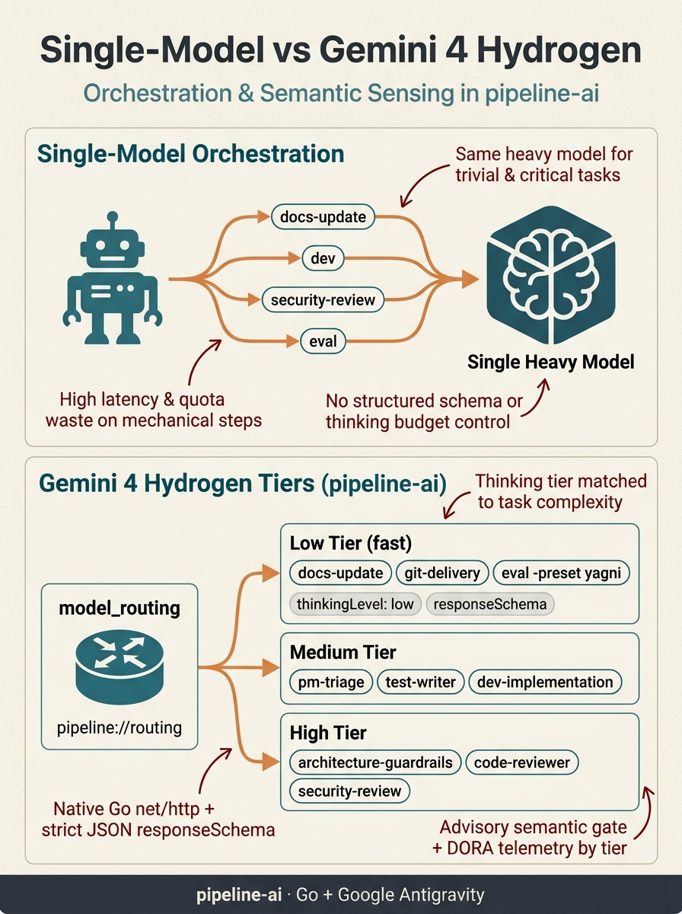
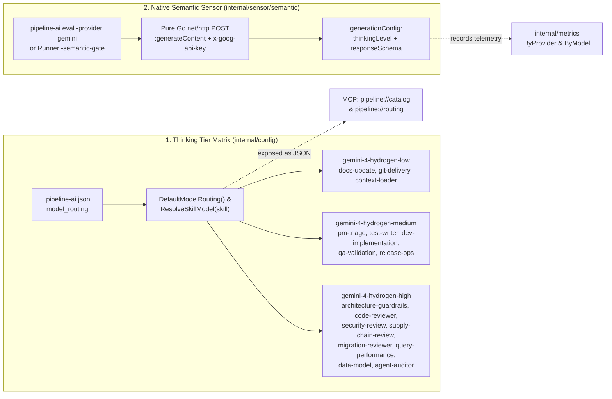

When a multi-agent workflow grows from two or three ad-hoc prompts into **16 specialized skills** — spanning triage and data modeling through TDD, code review, security auditing, and PR creation — a quiet engineering bottleneck emerges: **the cost and latency of Single-Model Orchestration.**

Using the same heavyweight frontier model at maximum reasoning effort to update a delivery index in `docs-ai/deliveries/INDEX.md` or open a PR in `git-delivery`, while also using it to audit security surfaces in `security-review` or architectural invariants in `architecture-guardrails`, wastes quota, inflates pipeline *Lead Time*, and adds zero quality to mechanical steps.

In this 6th technical article on the architecture of **Pipeline-AI** — covering the capabilities introduced in **release `v0.12.0` (DEL-039)** and their end-to-end integration in **`DEL-043` (D-44)** —, I show how **Gemini 4 Hydrogen** plays two complementary roles in the pipeline while keeping **100% adherence to the Go 1.24 standard library (zero external dependencies in `go.mod`)**.

---

## 1. The Single-Model Problem in Multi-Agent Pipelines

In deterministic AI-assisted pipelines, not every stage requires the same cognitive budget:
- **Mechanical and formatted stages:** updating delivery reports, synchronizing indexes, and running Git commands have rigid scopes and low ambiguity. Deep reasoning here only adds latency.
- **Implementation and triage stages:** turning requirements into tests (TDD), writing scoped code, and validating the test suite require a balance between speed and accuracy.
- **Critical architecture and security stages:** setting implementation boundaries before coding, reviewing diffs for subtle flaws, and auditing queries, DDL migrations, and security surfaces demand maximum analytical depth.

Without explicit capability routing, an orchestrator falls into one of two traps: either **over-provisioning everything** (paying maximum quota and latency for trivial tasks) or **under-provisioning everything** (degrading architectural and security reviews).

---

## 2. Two Roles for Gemini 4 Hydrogen in `pipeline-ai`

To resolve this trade-off deterministically and auditably, `pipeline-ai` uses **Gemini 4 Hydrogen** across two integrated layers:



### 2.1. Role 1: Thinking Tier Matrix (`model_routing` in `internal/config/config.go`)

In `internal/config/config.go`, the `model_routing` matrix deterministically maps every skill in the ecosystem to its recommended Gemini 4 Hydrogen tier via `DefaultModelRouting()` and `(*Config).ResolveSkillModel(skill string) string`:

| Tier | Model | Default Assigned Skills | Execution Profile |
|---|---|---|---|
| **Low** | `gemini-4-hydrogen-low` | `docs-update`, `git-delivery`, `context-loader` | High speed, low cost, mechanical & documentation tasks |
| **Medium** | `gemini-4-hydrogen-medium` | `pm-triage`, `test-writer`, `dev-implementation`, `qa-validation`, `release-ops` *(and default fallback)* | Balanced reasoning and latency for triage, TDD, and coding |
| **High** | `gemini-4-hydrogen-high` | `architecture-guardrails`, `code-reviewer`, `security-review`, `supply-chain-review`, `migration-reviewer`, `query-performance`, `data-model`, `agent-auditor` | Maximum analytical depth for guardrails, reviews, and security |

Any project can override individual mappings in `.pipeline-ai.json` via `model_routing`. When a skill has no local override, `ResolveSkillModel` falls back to `DefaultModelRouting()`, and for unknown skills it defaults safely to `gemini-4-hydrogen-medium`.

To let orchestrators and subagents inspect this matrix at runtime without parsing prose documentation, the MCP server exposes two structured resources:
- **`pipeline://catalog`** (D-41): full catalog of native skills, available modules, and `model_routing`.
- **`pipeline://routing`** (D-44): dedicated JSON resource returning the resolved Thinking Tier Matrix directly.

---

### 2.2. Role 2: Native Semantic Sensor (`internal/sensor/semantic`)

Beyond orchestrating subagents, `pipeline-ai` implements a native client for the `"gemini"` provider (`ProviderGemini = "gemini"`, `DefaultGeminiModel = "gemini-4-hydrogen-low"`, `DefaultGeminiThinkingLevel = "low"`) inside `internal/sensor/semantic/client.go`.

Instead of adding an external SDK to `go.mod`, calls to the `generateContent` endpoint (`https://generativelanguage.googleapis.com/v1beta/models/<model>:generateContent`) are implemented in **pure Go (`net/http`)**, leveraging two native Gemini 4 Hydrogen capabilities:
1. **`thinkingConfig.thinkingLevel`:** explicitly controls the reasoning budget (`low`, `medium`, or `high`) per semantic evaluation.
2. **`responseMimeType: "application/json"` + `responseSchema`:** enforces strict structured output matching the evaluation mode (`noul` boolean, `choice` multiple-choice with an `options` probability map, or continuous `score`).

#### Security Safeguards (SEC-01, SEC-02, and SEC-03)

Because the semantic sensor handles code diffs and communicates with an authenticated external API, three defense layers are built in:
- **SEC-01 (Header Authentication & Anti-Hallucination):** `GEMINI_API_KEY` is sent exclusively via the `x-goog-api-key` HTTP header — never as a `?key=` URL query parameter, preventing accidental leakage in `net/url` error messages or logs. In `choice` mode, the returned selection is validated against allowed choices (`ErrInvalidChoice`).
- **SEC-02 (Score Bounds & Normalization):** In `score` mode, values outside `[0, max_score]` trigger `ErrInvalidScore`.
- **SEC-03 (Secret Redaction, Payload Caps, and Timeouts):** Network or unexpected HTTP status errors pass through `sanitizeErr` (replacing the API key with `[REDACTED]`), response bodies are capped via `io.LimitReader` (default 10 MB `MaxBodyBytes`, returning `ErrResponseTooLarge`), and all requests enforce `context.WithTimeout`.

Furthermore, the Gemini response parser is continuously fuzz-tested via `FuzzParseGeminiResponse` (`internal/sensor/semantic/fuzz_test.go`), with **over 638,000 executions and zero panics**.

Usage from the CLI and MCP is straightforward:

```bash
export GEMINI_API_KEY="AIzaSy..."

# Binary evaluation (noul) with Thinking Tier low
pipeline-ai eval -provider gemini -model gemini-4-hydrogen-low -thinking-level low \
  -state "func foo() {}" -question "is the code complete?" -threshold 0.8

# Multiple-choice routing (choice)
pipeline-ai eval -provider gemini -mode choice \
  -state "SQL syntax error" -question "which skill should run?" \
  -choices "data-model,migration-reviewer,dev-implementation"
```

---

## 3. End-to-End Runner Integration and DORA Telemetry (`DEL-043`)

With delivery `DEL-043` (D-44), Gemini 4 Hydrogen moved beyond standalone `eval` calls to close the loop inside the **Pipeline Runner** and **DORA Telemetry**:

### 3.1. Optional 4th Advisory Stage in the Runner (`-semantic-gate`)

`pipeline-ai run` (and the MCP tool `pipeline_run_pipeline` with `semantic_gate: true`) now accepts the `-semantic-gate` flag, appending an optional 4th stage to the deterministic cascade:

```text
doctor → sensor → validate → semantic_gate (advisory)
```

Per architectural decision **D-44**, `semantic_gate` operates strictly in **advisory** mode:
- Without configured credentials (`GEMINI_API_KEY` or `JEV_ENDPOINT`), it returns `StatusSkip` without interrupting the pipeline.
- With credentials configured, it evaluates using the `yagni` preset, returning `StatusPass` or `StatusWarn` while applying `redactSecrets` to any error output.
- External API outages never flip a local deterministic pass (`gofmt`, `go vet`, `go test`) into `StatusFail`.

### 3.2. DORA Telemetry by Provider and Model (`internal/metrics`)

To provide real visibility into cost, adoption, and latency across providers and tiers, `internal/metrics/metrics.go` added:
- **`RecordSemanticEvalWithProvider(rootDir, deliveryID, mode, provider, model, duration, success, confidence)`**: records the provider (`gemini` or `jev`) and exact model (`gemini-4-hydrogen-low`, etc.) on every semantic event.
- **`SemanticSummary.ByProvider` and `SemanticSummary.ByModel`**: aggregations in the DORA summary (`pipeline-ai metrics summary -json`) tagged with `json:"...,omitempty"` for full backward compatibility with existing `.pipeline-state/metrics.json` files.

---

## 4. The 100% Go Stdlib Invariant (Zero External Dependencies)

A core engineering invariant of `pipeline-ai` is keeping `go.mod` completely free of external runtime dependencies:

```go
module github.com/rodrigodosanjosoliveira/pipeline-ai

go 1.24

tool (
	github.com/rodrigodosanjosoliveira/pipeline-ai/cmd/pipeline-hook
	github.com/rodrigodosanjosoliveira/pipeline-ai/cmd/pipeline-validate
)
```

There is no `require` block. The entire Gemini 4 Hydrogen integration — from the `net/http` client with `responseSchema` and `thinkingConfig` to tier routing, the JSON-RPC 2.0 MCP server, the Runner, and DORA telemetry — runs on **pure Go 1.24 stdlib**, ensuring static `CGO_ENABLED=0` binaries, fast builds, and minimal supply-chain surface.

---

## Conclusion

Separating **where** to think fast and cheap (**Hydrogen Low**) from **where** to think deeply (**Hydrogen High**), while coupling a **Native Semantic Sensor** with `responseSchema`, `thinkingLevel`, an advisory Runner gate, and `ByProvider`/`ByModel` DORA telemetry, turns multi-agent orchestration into predictable software engineering.

The full source code is available under the MIT license at:
- **Repository:** [github.com/rodrigodosanjosoliveira/pipeline-ai](https://github.com/rodrigodosanjosoliveira/pipeline-ai)
- **Architectural Decisions:** `docs-ai/DECISOES.md` (D-41 and D-44)
