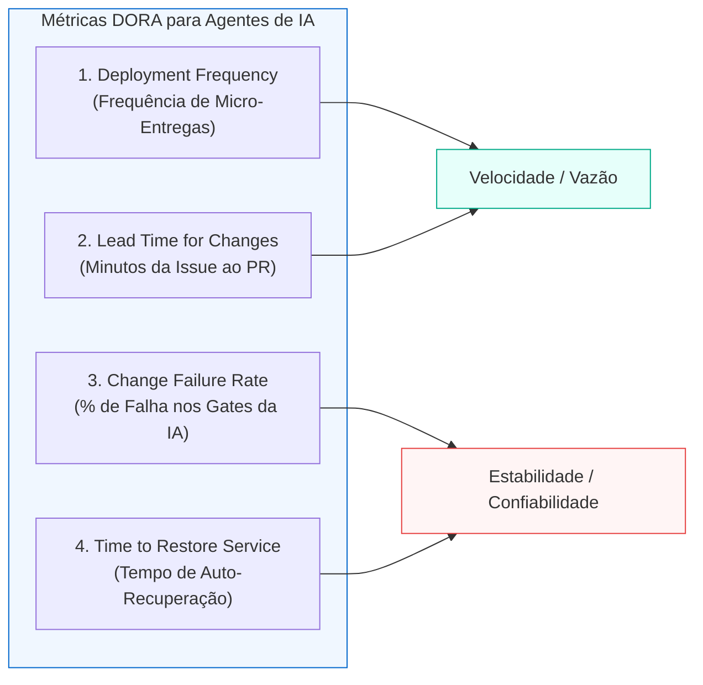

# DORA Metrics para Agentes de IA: Como Construí um Motor de Telemetria e Observabilidade em Go para Esteiras Autônomas

*Por Rodrigo Oliveira — Engenheiro de Software & Pós-Graduando em Engenharia de IA Aplicada*

---

Quem acompanha a evolução do desenvolvimento de software assistido por inteligência artificial já percebeu a mudança de fase. Entre 2023 e 2024, o foco era o deslumbramento com a velocidade de geração de código: quanto mais linhas um modelo como Claude, Devin ou Antigravity cuspia no terminal, mais impressionados ficávamos.

Porém, quando colocamos agentes autônomos para operar em projetos reais de engenharia, a pergunta que ecoa na liderança técnica — de Tech Leads a CTOs — é muito mais pragmática:

> **"Os agentes de IA estão realmente acelerando a engenharia de software da equipe, ou estão apenas aumentando a taxa de retrabalho, o débito técnico e o caos no repositório?"**

Para responder a essa pergunta com fatos e não com intuição, não precisamos reinventar a roda da gestão de engenharia. Precisamos recorrer ao padrão mais respeitado e comprovado da nossa indústria: as **Métricas DORA (DevOps Research and Assessment)**.

Neste artigo — celebrando a entrega **DEL-020 do framework Pipeline-AI** —, compartilho como redesenhamos e implementamos as quatro métricas DORA adaptadas para agentes autônomos de IA, construindo um **motor de telemetria determinístico em Go 1.24 puro (stdlib)**, com persistência atômica, salvaguardas validadas por Fuzzing e integração nativa via **Model Context Protocol (MCP)**.

---

## 1. Por que Métricas DORA para Agentes de IA?

As quatro métricas DORA foram criadas pelo time do Google Cloud / DORA após analisar milhares de equipes de engenharia ao redor do mundo. Elas equilibram duas forças vitais: **Velocidade de Entrega** (*Throughput*) e **Estabilidade do Sistema** (*Stability*).

Quando substituímos o desenvolvedor humano no teclado por múltiplos agentes especializados (Triage, Arquitetura, Testes, Implementação, Code Review, Segurança e QA), essas quatro métricas ganham uma nova dimensão em velocidade de máquina:



| Métrica DORA | Significado Tradicional (Engenharia Humana) | Adaptação para Agentes Autônomos (Pipeline-AI) |
|---|---|---|
| **Deployment Frequency (DF)** | Frequência de deploys em produção (por semana ou mês). | Número de micro-deliveries completas e validadas por dia (velocidade de máquina). |
| **Lead Time for Changes (LT)** | Tempo do commit até o código rodar em produção (dias ou semanas). | Tempo decorrido desde a abertura da issue no `pm-triage` até o PR validado no `git-delivery` (medido em **minutos**). |
| **Change Failure Rate (CFR)** | Percentual de deploys que causaram incidente em produção. | Percentual de execuções da esteira que foram bloqueadas ou falharam nos gates determinísticos da IA (*doctor*, *sensor*, *validate*). |
| **Time to Restore Service (MTTR)** | Tempo médio para restaurar o sistema após uma falha ou incidente. | Tempo que a esteira de agentes leva para corrigir um bloqueio técnico (`STATUS: bloqueado`) e retornar ao estado verde (`ok`). |

Se o seu agente gera 5.000 linhas de código por hora, mas o seu **Change Failure Rate (CFR)** nos gates de segurança e testes é de 60%, a IA não está te dando produtividade: ela está gerando resíduos e sobrecarregando o revisor humano.

---

## 2. A Arquitetura do Motor de Telemetria (`internal/metrics`)

No desenvolvimento do **Pipeline-AI**, seguimos um invariante sagrado: **Zero dependências externas**. Adicionar frameworks pesados de telemetria ou SDKs de SaaS proprietários aumentaria a superfície de ataque da supply chain e quebraria a portabilidade entre Linux, WSL2 e containers isolados.

Construímos o pacote `internal/metrics` utilizando estritamente a biblioteca padrão de Go 1.24:

```go
// internal/metrics/metrics.go
type DORAMetrics struct {
    DeploymentFrequency float64       `json:"deployment_frequency"` // Deploys por dia
    DeploymentsTotal    int           `json:"deployments_total"`
    LeadTimeForChanges  time.Duration `json:"lead_time_for_changes"` // Lead time médio/mediana
    ChangeFailureRate   float64       `json:"change_failure_rate"`   // Taxa percentual de falha (0.0 a 100.0)
    FailedDeployments   int           `json:"failed_deployments"`
    TimeToRestore       time.Duration `json:"time_to_restore"` // MTTR médio
    RestoresTotal       int           `json:"restores_total"`
}
```

### Persistência Atômica e Fail-Safe

Telemetria de agentes precisa ser resiliente: se a máquina for desligada ou um processo for cancelado no meio de uma gravação, o arquivo de métricas jamais pode ser corrompido.

Implementamos gravação atômica via arquivo temporário com `os.Rename` e concorrência protegida por `sync.Mutex`:

```go
func Save(rootDir string, data *MetricsData) error {
    mu.Lock()
    defer mu.Unlock()

    stateDir := filepath.Join(rootDir, DirName)
    _ = os.MkdirAll(stateDir, 0755)

    tmpFile := filepath.Join(stateDir, fmt.Sprintf("%s.tmp.%d", FileName, time.Now().UnixNano()))
    // Grava no arquivo temporário...
    if err := os.WriteFile(tmpFile, payload, 0644); err != nil {
        return err
    }
    // Operação atômica no nível do sistema de arquivos
    return os.Rename(tmpFile, targetFile)
}
```

Se o arquivo de métricas não existir (bootstrap de um projeto novo) ou estiver vazio, a função `Load` inicializa estruturas limpas automaticamente em vez de falhar. **A telemetria nunca pode derrubar o pipeline de compilação.**

---

## 3. Blindagem com Fuzz Testing: Mais de 1 Milhão de Execuções

Em sistemas dirigidos por LLMs, dados em formato JSON podem vir truncados, corrompidos ou com caracteres invisíveis. Para garantir que o parser do motor de métricas fosse imune a panics e vulnerabilidades de negação de serviço (DoS), escrevemos um alvo de **Fuzzing nativo em Go**:

```go
// internal/metrics/metrics_fuzz_test.go
func FuzzParseMetrics(f *testing.F) {
    f.Add([]byte(`{"version":1,"events":[],"stages":[],"deliveries":[]}`))
    f.Add([]byte(`{"version":1,"deliveries":[{"delivery_id":"DEL-001","success":true,"lead_time":600000000000}]}`))
    f.Add([]byte(``))
    f.Add([]byte(`null`))
    f.Add([]byte(`{"corrupted": true`))

    f.Fuzz(func(t *testing.T, data []byte) {
        md, err := ParseMetrics(data)
        if err != nil {
            return // Erro tratado é o comportamento esperado para dados inválidos
        }
        if md == nil {
            t.Fatalf("ParseMetrics retornou nil sem erro para entrada válida")
        }
    })
}
```

Submetemos o parser a **mais de 1.130.000 iterações aleatórias contínuas** (`go test -fuzz=FuzzParseMetrics -fuzztime=10s`), atingindo 100% de estabilidade com zero crashes.

---

## 4. Instrumentação Transparente no Pipeline Runner

Em vez de exigir que cada agente registre manualmente quando começou ou terminou seu trabalho, instrumentamos o **Pipeline Runner (`internal/runner`)**.

Toda vez que o comando `pipeline-ai run` é executado, ele mede a latência em nanossegundos e registra o status de cada fase:

```go
// Trecho da instrumentação em internal/runner/runner.go
docStart := time.Now()
docResults, docOK := doctor.Collect(absRoot)
docDur := time.Since(docStart)
_ = metrics.RecordStageDuration(absRoot, deliveryID, "doctor", docDur, docOK)

sensorStart := time.Now()
sensorRes, err := sensor.Run(absRoot)
sensorDur := time.Since(sensorStart)
_ = metrics.RecordStageDuration(absRoot, deliveryID, "sensor", sensorDur, sensorStep.Status == StatusPass)

valStart := time.Now()
valStep := validate.Run(...)
valDur := time.Since(valStart)
_ = metrics.RecordStageDuration(absRoot, deliveryID, "validate", valDur, validateStep.Status == StatusPass)

// Grava o evento global de gate
_ = metrics.RecordEvent(absRoot, metrics.Event{
    Type:       metrics.EventGate,
    DeliveryID: deliveryID,
    Timestamp:  time.Now().UTC(),
    Duration:   time.Since(runStart),
    Success:    allOK,
    Stage:      "runner",
})
```

Isso garante **observabilidade passiva**: os agentes executam suas tarefas normalmente enquanto a telemetria é coletada sem atrito.

---

## 5. Consultando Métricas na CLI e via Protocolo MCP

As métricas coletadas estão disponíveis tanto para engenheiros humanos no terminal quanto para os próprios agentes através do **Model Context Protocol (MCP)**.

### Na Linha de Comando (CLI):
```bash
$ pipeline-ai metrics summary
Métricas DORA do Pipeline:
  Deployment Frequency:    3.50 deploys/dia (total: 20)
  Lead Time for Changes:   8m 42s
  Change Failure Rate:     5.0% (falhas: 1)
  Time to Restore Service: 4m 15s (restaurações: 1)
```

Ou em JSON estruturado para ingestão em dashboards corporativos:
```bash
$ pipeline-ai metrics summary -json
{
  "deployment_frequency": 3.5,
  "deployments_total": 20,
  "lead_time_for_changes": 522000000000,
  "change_failure_rate": 5.0,
  "failed_deployments": 1,
  "time_to_restore": 255000000000,
  "restores_total": 1
}
```

### No Servidor MCP (`pipeline_get_metrics`):
O orquestrador de IA pode invocar nativamente a tool MCP:
```json
{
  "name": "pipeline_get_metrics",
  "arguments": {
    "dir": "."
  }
}
```
Isso permite que a própria IA avalie seu histórico: se o `Change Failure Rate` nos testes começar a subir, o orquestrador pode acionar automaticamente guardrails mais rígidos ou alocar turnos adicionais para a fase de TDD (*test-writer*).

---

## O Impacto: Da Velocidade Cega à Confiabilidade Mensurável

Gerar código rápido sem telemetria é como dirigir um carro de corrida com o painel desligado: você pode estar acelerando, mas não tem como saber se o motor está prestes a fundir.

Ao aplicar **DORA Metrics em esteiras de agentes autônomos**, alcançamos três benefícios imediatos:

1. **Visibilidade de Gargalos:** Sabemos exatamente quantos segundos são gastos no *test-writer*, na compilação cruzada ou no *code-reviewer*.
2. **Defesa contra Ilusões de Produtividade:** Um agente que escreve 1.000 linhas mas gera um *Change Failure Rate* alto é sumariamente barrado pelos sensores.
3. **Padrão de Engenharia de Confiabilidade de Agentes (ARE):** Elevamos o uso de IA do patamar de "brinquedo experimental" para um processo industrial auditável, quantitativo e governado.

---

O código do **Pipeline-AI**, incluindo o pacote de telemetria `internal/metrics`, o runner determinístico e a suíte de 16 skills em Go puro, é 100% open-source sob licença MIT:

👉 **Repositório Oficial:** [github.com/rodrigodosanjosoliveira/pipeline-ai](https://github.com/rodrigodosanjosoliveira/pipeline-ai)

Como você tem medido o impacto e a confiabilidade das ferramentas de IA na sua equipe de engenharia? Compartilhe seus desafios e métricas nos comentários! 💬📊🚀
