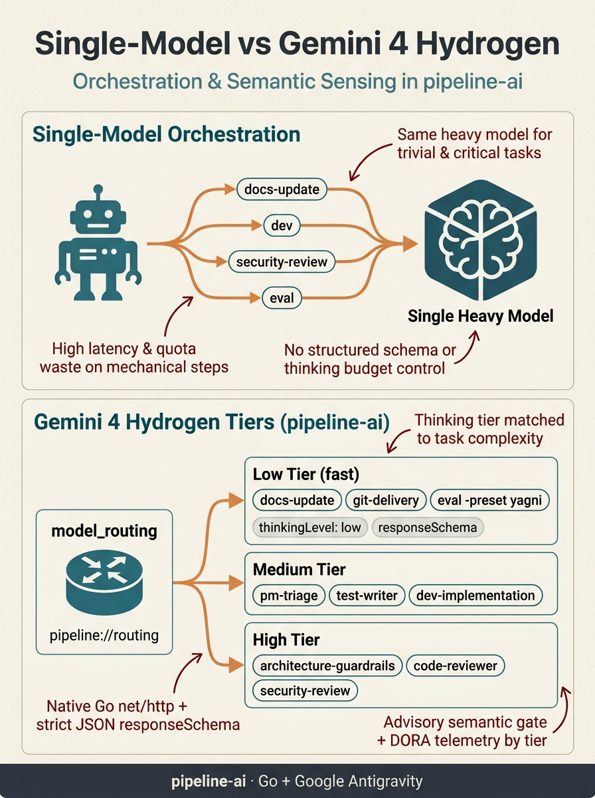
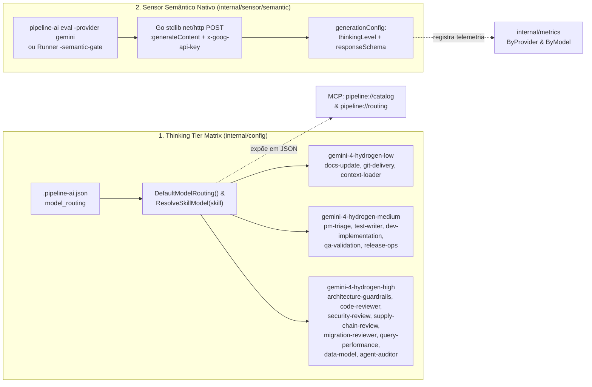

# Gemini 4 Hydrogen na Prática: Thinking Tier Routing, Sensor Semântico Nativo e Telemetria DORA em Go Puro

*Por Rodrigo Oliveira — Engenheiro de Software & Pós-Graduando em Engenharia de IA Aplicada*

---



Quando uma esteira multiagente cresce de 2 ou 3 prompts isolados para **16 skills especializadas** — cobrindo desde triagem e modelagem de dados até TDD, code review, auditoria de segurança e abertura de Pull Request —, surge um gargalo silencioso de engenharia: **o custo e a latência da orquestração de modelo único (*Single-Model Orchestration*).**

Usar o mesmo modelo pesado de fronteira com raciocínio máximo para atualizar um índice em `docs-ai/deliveries/INDEX.md` ou abrir um PR no `git-delivery` e, ao mesmo tempo, para auditar superfícies de segurança em `security-review` ou invariantes em `architecture-guardrails` desperdiça cota, aumenta o *Lead Time* da esteira e não melhora a qualidade das etapas mecânicas.

Neste 6º artigo técnico da série sobre a arquitetura do **Pipeline-AI** — cobrindo a evolução consolidada na **release `v0.12.0` (DEL-039)** e sua integração ponta a ponta em **`DEL-043` (D-44)** —, apresento como o **Gemini 4 Hydrogen** assume dois papéis complementares na esteira, mantendo **100% de aderência à standard library do Go 1.24 (zero dependências externas no `go.mod`)**.

---

## 1. O Problema do Modelo Único em Esteiras Multiagentes

Em pipelines determinísticos assistidos por IA, nem toda etapa exige o mesmo orçamento cognitivo:
- **Etapas mecânicas e formatadas:** atualizar relatórios de delivery, sincronizar índices e executar comandos de Git têm escopo rígido e baixo risco de ambiguidade. Raciocínio profundo aqui gera latência desnecessária.
- **Etapas de implementação e triagem:** transformar requisitos em testes (TDD), implementar código aderente ao escopo e validar a suíte completa exigem equilíbrio entre velocidade e precisão.
- **Etapas críticas de arquitetura e segurança:** definir limites antes do código, revisar diffs buscando falhas sutis, auditar queries, migrações DDL e superfícies sensíveis exigem profundidade máxima de análise.

Sem um mecanismo explícito de roteamento por capacidade, o orquestrador cai em um dos dois extremos: ou **superdimensiona tudo** (pagando cota e tempo máximos em tarefas triviais) ou **subdimensiona tudo** (degradando revisões arquiteturais e de segurança).

---

## 2. Os Dois Papéis do Gemini 4 Hydrogen no `pipeline-ai`

Para resolver esse trade-off de forma determinística e auditável, o `pipeline-ai` utiliza o **Gemini 4 Hydrogen** em duas frentes integradas:



### 2.1. Papel 1: Thinking Tier Matrix (`model_routing` em `internal/config/config.go`)

No pacote `internal/config/config.go`, a matriz `model_routing` mapeia deterministicamente cada skill do ecossistema para o tier recomendado do Gemini 4 Hydrogen por meio de `DefaultModelRouting()` e `(*Config).ResolveSkillModel(skill string) string`:

| Tier | Modelo | Skills Atribuídas por Padrão | Perfil de Execução |
|---|---|---|---|
| **Low** | `gemini-4-hydrogen-low` | `docs-update`, `git-delivery`, `context-loader` | Alta velocidade, baixo custo, etapas mecânicas e de documentação |
| **Medium** | `gemini-4-hydrogen-medium` | `pm-triage`, `test-writer`, `dev-implementation`, `qa-validation`, `release-ops` *(e fallback padrão)* | Equilíbrio entre raciocínio e latência para triagem, TDD e implementação |
| **High** | `gemini-4-hydrogen-high` | `architecture-guardrails`, `code-reviewer`, `security-review`, `supply-chain-review`, `migration-reviewer`, `query-performance`, `data-model`, `agent-auditor` | Máxima profundidade analítica para guardrails, revisões e segurança |

Qualquer projeto pode sobrescrever pontualmente o roteamento no arquivo `.pipeline-ai.json` usando o campo `model_routing`. Quando uma skill não possui sobrescrita local, `ResolveSkillModel` recorre a `DefaultModelRouting()` e, para skills desconhecidas, aplica o fallback seguro `gemini-4-hydrogen-medium`.

Para que o orquestrador e os subagentes consultem essa matriz em tempo de execução sem parsear documentação em texto livre, o servidor MCP expõe dois recursos estruturados:
- **`pipeline://catalog`** (D-41): catálogo completo de skills nativas, módulos disponíveis e `model_routing`.
- **`pipeline://routing`** (D-44): recurso JSON dedicado retornando diretamente a Thinking Tier Matrix resolvida.

---

### 2.2. Papel 2: Sensor Semântico Nativo (`internal/sensor/semantic`)

Além de orquestrar os subagentes, o `pipeline-ai` implementa um cliente nativo para o provider `"gemini"` (`ProviderGemini = "gemini"`, `DefaultGeminiModel = "gemini-4-hydrogen-low"`, `DefaultGeminiThinkingLevel = "low"`) dentro de `internal/sensor/semantic/client.go`.

Em vez de adicionar um SDK externo ao `go.mod`, a chamada à API `generateContent` (`https://generativelanguage.googleapis.com/v1beta/models/<model>:generateContent`) é feita em **Go puro (`net/http`)**, utilizando dois recursos nativos do Gemini 4 Hydrogen:
1. **`thinkingConfig.thinkingLevel`:** controla explicitamente o orçamento de raciocínio (`low`, `medium` ou `high`) por chamada semântica.
2. **`responseMimeType: "application/json"` + `responseSchema`:** força a saída estruturada estrita de acordo com o modo da avaliação (`noul` booleano, `choice` múltipla escolha com mapa de probabilidades `options`, ou `score` contínuo).

#### Salvaguardas de Segurança (SEC-01, SEC-02 e SEC-03)

Como o sensor semântico recebe diffs de código e se comunica com uma API externa autenticada, três camadas de proteção são aplicadas por construção:
- **SEC-01 (Autenticação por Header & Anti-Hallucination):** A chave `GEMINI_API_KEY` é enviada exclusivamente via header HTTP `x-goog-api-key` — nunca como query parameter `?key=` na URL, evitando vazamento em logs de erro de `net/url`. No modo `choice`, a resposta selecionada é validada contra a lista permitida (`ErrInvalidChoice`).
- **SEC-02 (Bounds e Normalização em Scores):** No modo `score`, valores fora dos limites válidos `[0, max_score]` disparam `ErrInvalidScore`.
- **SEC-03 (Redação de Segredos, Limite de Payload e Timeout):** Erros de rede ou status HTTP inesperados passam por `sanitizeErr` (substituindo a chave por `[REDACTED]`), o corpo da resposta é limitado via `io.LimitReader` (`MaxBodyBytes` padrão de 10 MB, retornando `ErrResponseTooLarge`) e todas as chamadas respeitam `context.WithTimeout`.

Além disso, o parser de respostas do Gemini é submetido continuamente a fuzz testing por meio de `FuzzParseGeminiResponse` (`internal/sensor/semantic/fuzz_test.go`), acumulando **mais de 638 mil execuções sem panics**.

Na CLI e no MCP, o uso é direto:

```bash
export GEMINI_API_KEY="AIzaSy..."

# Avaliação binária (noul) com Thinking Tier low
pipeline-ai eval -provider gemini -model gemini-4-hydrogen-low -thinking-level low \
  -state "func foo() {}" -question "o código está completo?" -threshold 0.8

# Roteamento de múltipla escolha (choice)
pipeline-ai eval -provider gemini -mode choice \
  -state "erro SQL syntax" -question "qual skill acionar?" \
  -choices "data-model,migration-reviewer,dev-implementation"
```

---

## 3. Integração End-to-End no Runner e Telemetria DORA (`DEL-043`)

Com a entrega `DEL-043` (D-44), o Gemini 4 Hydrogen deixou de atuar apenas no comando isolado `eval` e fechou o ciclo completo dentro do **Pipeline Runner** e da **Telemetria DORA**:

### 3.1. 4º Estágio Advisory no Runner (`-semantic-gate`)

O comando `pipeline-ai run` (e a ferramenta MCP `pipeline_run_pipeline` com `semantic_gate: true`) passa a aceitar a flag `-semantic-gate`, adicionando o 4º estágio opcional ao final da cascata:

```text
doctor → sensor → validate → semantic_gate (advisory)
```

Seguindo a decisão arquitetural **D-44**, o `semantic_gate` opera estritamente em modo **advisory**:
- Sem credenciais configuradas (`GEMINI_API_KEY` ou `JEV_ENDPOINT`), retorna `StatusSkip` sem interromper a esteira.
- Com credenciais configuradas, executa a avaliação com o preset `yagni` retornando `StatusPass` ou `StatusWarn`, aplicando `redactSecrets` em qualquer mensagem de erro.
- Nunca converte indisponibilidade externa de API em `StatusFail`, preservando o determinismo dos gates locais (`gofmt`, `go vet`, `go test`).

### 3.2. Telemetria DORA por Provider e Model (`internal/metrics`)

Para dar visibilidade real sobre custo, adoção e latência entre providers e tiers, `internal/metrics/metrics.go` introduziu:
- **`RecordSemanticEvalWithProvider(rootDir, deliveryID, mode, provider, model, duration, success, confidence)`**: registra o provider (`gemini` ou `jev`) e o modelo específico (`gemini-4-hydrogen-low`, etc.) em cada evento semântico.
- **`SemanticSummary.ByProvider` e `SemanticSummary.ByModel`**: agregações no resumo DORA (`pipeline-ai metrics summary -json`) anotadas com `json:"...,omitempty"` para garantir 100% de retrocompatibilidade com arquivos `.pipeline-state/metrics.json` existentes.

---

## 4. Invariante de 100% Go Stdlib (Zero Dependências Externas)

Um ponto central da engenharia do `pipeline-ai` é manter o `go.mod` limpo:

```go
module github.com/rodrigodosanjosoliveira/pipeline-ai

go 1.24

tool (
	github.com/rodrigodosanjosoliveira/pipeline-ai/cmd/pipeline-hook
	github.com/rodrigodosanjosoliveira/pipeline-ai/cmd/pipeline-validate
)
```

Não há bloco `require`. Toda a integração com o Gemini 4 Hydrogen — do cliente HTTP com `responseSchema` e `thinkingConfig` ao roteamento de tiers, servidor MCP JSON-RPC 2.0, Runner e telemetria DORA — roda em **Go 1.24 stdlib pura**, garantindo binários estáticos com `CGO_ENABLED=0`, builds rápidos e superfície mínima de supply chain.

---

## Conclusão

Separar **onde** pensar pouco e rápido (**Hydrogen Low**) de **onde** pensar profundamente (**Hydrogen High**), enquanto se acopla um **Sensor Semântico Nativo** com `responseSchema`, `thinkingLevel`, gate advisory no Runner e telemetria DORA `ByProvider`/`ByModel`, transforma a orquestração multiagente em engenharia previsível.

O código completo está disponível sob licença MIT em:
- **Repositório:** [github.com/rodrigodosanjosoliveira/pipeline-ai](https://github.com/rodrigodosanjosoliveira/pipeline-ai)
- **Decisões Arquiteturais:** `docs-ai/DECISOES.md` (D-41 e D-44)
