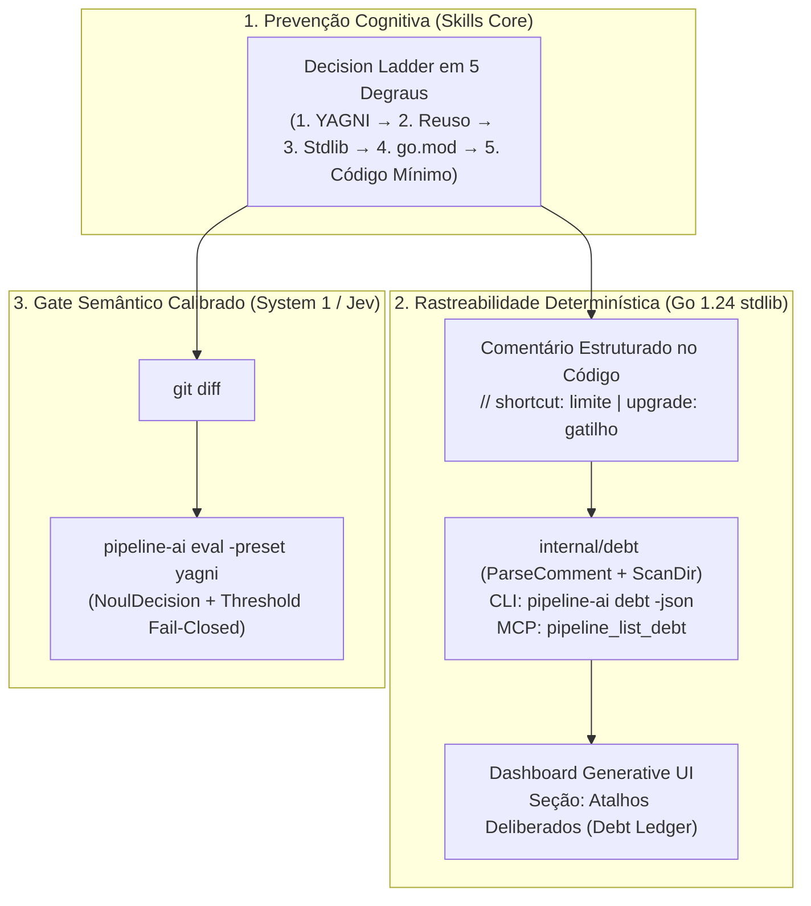

# O Paradoxo da Produtividade em IA: Como Combater o Over-Engineering dos LLMs com Decision Ladders, Debt Ledgers Determinísticos e Sensores YAGNI

*Por Rodrigo Oliveira — Engenheiro de Software & Pós-Graduando em Engenharia de IA Aplicada*

---

Existe um paradoxo silencioso nas equipes que adotaram agentes de IA para escrever código em larga escala: **nunca geramos tantas linhas de código por minuto e, ao mesmo tempo, nunca acumulamos tanta complexidade acidental em tão pouco tempo.**

Peça a um LLM de fronteira para implementar uma persistência simples de carteiras financeiras em Go. Se não houver freios arquiteturais rígidos, em menos de trinta segundos ele provavelmente entregará:
- Uma interface `WalletRepository` com uma única implementação concreta no mesmo pacote (violando o idioma clássico de Go onde interfaces pertencem ao consumidor);
- Um `AbstractStorageFactory` com padrão Strategy para um banco de dados que nunca mudará;
- Três structs duplicadas do domínio (`CreditCard`, `VoucherBalance`, `WeeklyEnvelope`) que já existiam consolidadas em uma única entidade `domain.Wallet`;
- Um wrapper próprio sobre `database/sql` e meia dúzia de comentários `// TODO: optimize later` espalhados pelo caminho.

O código compila? Às vezes nem isso — quando alucina tipos que não batem com o pacote `domain`. E, quando compila, você acabou de herdar 800 linhas de **over-engineering especulativo** para resolver um problema de 120 linhas.

Neste 5º artigo técnico da série sobre a arquitetura do **Pipeline-AI** — celebrando o lançamento da **versão `v0.11.0` (entregas DEL-032 a DEL-035)** —, apresento como atacamos a raiz do viés aditivo dos LLMs combinando **Decision Ladders no fluxo cognitivo**, um **Debt Ledger determinístico em Go 1.24 puro (`internal/debt`)** e um **Sensor Semântico Calibrado YAGNI (`pipeline-ai eval -preset yagni`)**, além de demonstrar os resultados reais em produção no projeto **`gestao-financas`**.

---

## 1. Por que os LLMs Sofrem de Viés Aditivo Crônico?

Modelos de linguagem de grande porte (LLMs) foram treinados sobre bilhões de linhas de repositórios públicos e tutoriais corporativos onde "arquitetura limpa" frequentemente é confundida com **excesso de camadas de indireção**. Além disso, o treinamento por reforço com feedback humano (RLHF) tende a recompensar respostas longas, "completas" e aparentemente sofisticadas.

Na prática da engenharia de software, isso se manifesta em quatro patologias recorrentes:
1. **Abstração Prematura (Violação de YAGNI):** Criação de interfaces genéricas, canais de eventos e opções de configuração para requisitos futuros que ninguém pediu.
2. **Duplicação e Alucinação de Tipos de Domínio:** Em vez de inspecionar as structs existentes no pacote `internal/domain`, o agente inventa novas structs locais que fragmentam o modelo mental do sistema.
3. **Reimplementação da Standard Library:** Em Go, onde a biblioteca padrão (`net/http`, `database/sql`, `encoding/json`, `context`, `io`) já resolve 90% dos problemas de infraestrutura, LLMs insistem em criar wrappers ou puxar dependências externas desnecessárias no `go.mod`.
4. **Dívida Técnica Invisível (`TODO` Órfãos):** Quando o agente toma um atalho real (como usar um mapa em memória ou serializar um campo em JSONB), ele deixa um comentário genérico `// TODO: fix later` — ou nenhum comentário — sem documentar **qual é o limite operacional daquele atalho** nem **qual gatilho objetivo exige sua evolução**.

---

## 2. Inspiração e Evolução Arquitetural: De Regras de Prompt (`ponytail`) à Governança Determinística + System 1 (`pipeline-ai v0.11.0`)

Recentemente, o projeto open-source [`dietrichgebert/ponytail`](https://github.com/dietrichgebert/ponytail) sintetizou com brilhantismo uma filosofia que todo engenheiro sênior conhece:

> *"The best code is the code you never wrote."*

O `ponytail` introduziu três ideias conceituais excelentes para guiar agentes de código: uma escada de decisão (*Decision Ladder*), disciplina de minimalismo e a exigência de anotar atalhos de engenharia com comentários estruturados.

Contudo, ao analisarmos essa abordagem sob a ótica da arquitetura do **Pipeline-AI**, identificamos uma limitação estrutural: **regras que vivem apenas em texto de prompt (System 2) sofrem de degradação de atenção (*context drift*)**. Quando a janela de contexto cresce durante uma sessão longa de TDD, o LLM simplesmente esquece a instrução do prompt ou ignora os comentários `// shortcut:` que ficaram espalhados nos arquivos.

Para transformar boas intenções de prompt em **engenharia determinística e auditável**, o **`pipeline-ai v0.11.0`** evoluiu esses conceitos em três dimensões inéditas:
- **De Prompt Passivo para Parser & Scanner Determinístico em Go (`internal/debt`):** Os comentários `// shortcut:` deixam de ser texto morto no código e passam a ser extraídos, validados e inventariados por um motor em Go 1.24 puro (`pipeline-ai debt`), exposto via CLI, servidor MCP (`pipeline_list_debt`) e renderizado automaticamente no **Dashboard Generative UI**.
- **Blindagem contra `TODO` Vagos + Rastreabilidade de Atalhos Conscientes:** No Pipeline-AI, o validador de entregas (`pipeline-validate`) já bloqueia marcadores `TODO` ou `FIXME` órfãos. Agora, diferenciamos **pendência esquecida** (proibida) de **atalho arquitetural deliberado** (auditado com limite e gatilho explícitos).
- **Do "LLM-as-a-Judge" Lento para o Sensor Semântico Calibrado (System 1 / Jev):** Criamos o preset nativo `pipeline-ai eval -preset yagni`, permitindo que agentes e pipelines de CI submetam qualquer `git diff` a um sensor calibrado de baixíssima latência (`/v1/noul`) para detectar over-engineering antes do code review humano.



---

## 3. Os Três Pilares Anti-Overengineering do `pipeline-ai v0.11.0`

### 3.1. Pilar 1: A Decision Ladder nas Skills Core (`architecture-guardrails`, `dev-implementation` e `code-reviewer`)

Antes de escrever uma única linha de código ou propor um novo pacote, a skill `architecture-guardrails` agora obriga a passagem explícita pelos **5 degraus da Escada de Decisão (Decision Ladder)**:

1. **Degrau 1 — YAGNI (*You Aren't Gonna Need It*):** A mudança é realmente necessária para atender ao escopo atual da delivery ou estamos projetando para um futuro hipotético? Se for especulativa, corte imediatamente.
2. **Degrau 2 — Reuso Interno no Repositório:** Já existe uma struct, função ou tipo no pacote `internal/domain` ou em outro pacote interno que resolve o problema? Nunca crie structs espelhadas ou tipos duplicados.
3. **Degrau 3 — Standard Library do Go 1.24+:** A biblioteca padrão do Go (`net/http`, `database/sql`, `encoding/json`, `slices`, `maps`, `sync`, `context`) já oferece a primitiva necessária? Se sim, use-a diretamente sem wrappers.
4. **Degrau 4 — Dependência já presente no `go.mod`:** Se a stdlib não cobrir, existe algo já aprovado no grafo atual do projeto sem adicionar novas dependências?
5. **Degrau 5 — Código Novo Mínimo Viável:** Somente se os 4 degraus anteriores não bastarem, escreva a menor quantidade possível de código concreto, sem interfaces de implementação única no pacote produtor.

Em seguida, a skill `dev-implementation` impõe o **minimalismo estrito** na codificação, e o `code-reviewer` audita o `git diff` buscando especificamente abstrações especulativas e interfaces desnecessárias.

---

### 3.2. Pilar 2: O Debt Ledger Determinístico (`internal/debt`, `pipeline-ai debt` e MCP `pipeline_list_debt`)

Ser minimalista não significa fingir que um código simples aguenta escala infinita. Quando optamos conscientemente por uma implementação simples (por exemplo, um lock em memória ou uma consulta SQL direta sem cache distribuído), precisamos registrar esse **atalho deliberado** com duas informações obrigatórias:
- **Qual é o limite conhecido da solução atual?** (`<limite>`)
- **Qual é o gatilho objetivo e mensurável para evoluí-la no futuro?** (`<gatilho>`)

Padronizamos essa anotação diretamente no código Go com a sintaxe:

```go
// shortcut: <limite conhecido> | upgrade: <gatilho objetivo de evolução>
```

Para extrair e auditar essas anotações em qualquer repositório Go sem depender de expressões regulares complexas (que podem sofrer de *catastrophic backtracking* / ReDoS), construímos o pacote `internal/debt` em Go 1.24 puro:

```go
// internal/debt/debt.go
package debt

// ShortcutItem representa um atalho deliberado rastreado por limite e gatilho de evolução.
type ShortcutItem struct {
	File           string `json:"file"`
	Line           int    `json:"line"`
	Limit          string `json:"limit"`
	UpgradeTrigger string `json:"upgrade_trigger"`
	Raw            string `json:"raw"`
}

// ParseComment extrai o limite conhecido e o gatilho de evolução de comentários no formato:
// "// shortcut: <limite> | upgrade: <gatilho>" ou "// shortcut: <limite>, <gatilho>"
func ParseComment(line string) (limit string, trigger string, ok bool) {
	idx := strings.Index(line, "//")
	if idx == -1 {
		return "", "", false
	}

	comment := strings.TrimSpace(line[idx+2:])
	if len(comment) < len("shortcut:") || !strings.EqualFold(comment[:len("shortcut:")], "shortcut:") {
		return "", "", false
	}

	rest := strings.TrimSpace(comment[len("shortcut:"):])
	if pipeIdx := strings.Index(rest, "|"); pipeIdx != -1 {
		limit = strings.TrimSpace(rest[:pipeIdx])
		right := strings.TrimSpace(rest[pipeIdx+1:])
		if len(right) >= len("upgrade:") && strings.EqualFold(right[:len("upgrade:")], "upgrade:") {
			trigger = strings.TrimSpace(right[len("upgrade:"):])
		} else {
			trigger = right
		}
	} else if commaIdx := strings.Index(rest, ","); commaIdx != -1 {
		limit = strings.TrimSpace(rest[:commaIdx])
		right := strings.TrimSpace(rest[commaIdx+1:])
		if len(right) >= len("upgrade:") && strings.EqualFold(right[:len("upgrade:")], "upgrade:") {
			trigger = strings.TrimSpace(right[len("upgrade:"):])
		} else {
			trigger = right
		}
	} else {
		return "", "", false
	}

	if limit == "" || trigger == "" {
		return "", "", false
	}
	return limit, trigger, true
}
```

O scanner `debt.ScanDir(rootDir)`:
- Varre recursivamente a árvore de diretórios via `filepath.WalkDir`;
- Ignora deterministicamente arquivos de teste (`*_test.go`), pastas ocultas (`.git`, `.agents`), `vendor` e `node_modules`;
- Ignora comentários `// TODO:` tradicionais ou `// shortcut:` incompletos que não declarem gatilho de evolução;
- Ordena os resultados por arquivo e linha (`File`, `Line`) e foi submetido a **mais de 6,5 milhões de execuções de Fuzz Testing (`FuzzParseComment`)** com zero panics.

Com isso, qualquer engenheiro ou agente de IA pode inspecionar instantaneamente o inventário de atalhos deliberados via terminal ou MCP:

```text
$ pipeline-ai debt
Atalhos Deliberados (Debt Ledger): 2 encontrado(s)
- internal/storage/postgres.go:68 | Limite: serialização JSONB de recurrence e sub_items na coluna da carteira | Gatilho de evolução: extrair para tabelas relacionais se houver query analítica por sub-item
- internal/storage/storage.go:48 | Limite: MemoryStore guarda estado apenas em RAM com RWMutex local | Gatilho de evolução: usar PostgresStore quando DATABASE_URL estiver configurado em produção
```

Ou em JSON estruturado (`pipeline-ai debt -json` / tool MCP `pipeline_list_debt`):

```json
{
  "total": 2,
  "items": [
    {
      "file": "internal/storage/postgres.go",
      "line": 68,
      "limit": "serialização JSONB de recurrence e sub_items na coluna da carteira",
      "upgrade_trigger": "extrair para tabelas relacionais se houver query analítica por sub-item",
      "raw": "// shortcut: serialização JSONB de recurrence e sub_items na coluna da carteira | upgrade: extrair para tabelas relacionais se houver query analítica por sub-item"
    },
    {
      "file": "internal/storage/storage.go",
      "line": 48,
      "limit": "MemoryStore guarda estado apenas em RAM com RWMutex local",
      "upgrade_trigger": "usar PostgresStore quando DATABASE_URL estiver configurado em produção",
      "raw": "// shortcut: MemoryStore guarda estado apenas em RAM com RWMutex local | upgrade: usar PostgresStore quando DATABASE_URL estiver configurado em produção"
    }
  ]
}
```

Além disso, o comando `pipeline-ai dashboard` agora inclui automaticamente a tabela **"Atalhos Deliberados (Debt Ledger)"** no cockpit Generative UI, dando visibilidade executiva e técnica sobre cada decisão de simplicidade tomada no projeto.

---

### 3.3. Pilar 3: O Preset Semântico YAGNI no Sensor Jev (`pipeline-ai eval -preset yagni`)

Como garantir que um `git diff` recém-implementado realmente respeitou a Decision Ladder sem precisar invocar um modelo lento de raciocínio profundo?

No pacote `internal/sensor/semantic`, adicionamos o resolvedor de presets calibrados `ResolvePreset` (`yagni`, com aliases `minimalism` e `ponytail`), que configura automaticamente uma decisão binária calibrada (`EvalNoul` em `/v1/noul`) com a pergunta de auditoria anti-bloat:

```go
// internal/sensor/semantic/presets.go
const yagniQuestion = "Este código respeita estritamente o princípio YAGNI e minimalismo, sem overengineering, interfaces de implementação única desnecessárias, tipos duplicados do domínio ou abstrações especulativas não solicitadas?"

func ResolvePreset(name string) (mode string, question string, err error) {
	switch strings.ToLower(strings.TrimSpace(name)) {
	case "yagni", "minimalism", "ponytail":
		return "noul", yagniQuestion, nil
	default:
		return "", "", ErrInvalidPreset
	}
}
```

Na prática, validar semanticamente um diff na esteira passa a ser um comando de linha única:

```bash
git diff | pipeline-ai eval -preset yagni -threshold 0.80
```

Se o sensor System 1 detectar abstrações especulativas ou se a confiança calibrada ficar abaixo de `0.80`, o comando falha de forma *fail-closed* (`exit code 1`) e registra o evento automaticamente na telemetria semântica das métricas DORA.

---

## 4. Estudo de Caso Real em Produção: A Camada `internal/storage` do Projeto `gestao-financas`

Para comprovar o impacto concreto dessa governança, aplicamos o `pipeline-ai v0.11.0` ao desenvolvimento da camada de persistência (`internal/storage`) do sistema **`gestao-financas`** (uma aplicação desktop/API em Go + Wails v3 + PostgreSQL para gestão financeira pessoal por envelopes semanais, cartões de crédito e benefícios VA/VR).

### O Cenário Antes da Decision Ladder (A Armadilha da Alucinação Aditiva)

Em um rascunho anterior gerado sem a Decision Ladder, um agente de IA tentou implementar `internal/storage` criando estruturas paralelas da sua própria imaginação (`CreditCard`, `VoucherBalance`, `WeeklyEnvelope`, `MonthlySummary`) e métodos que não existiam em `internal/domain`. O resultado imediato:
- `go vet ./...` e `go test ./...` falharam com **mais de 15 erros de compilação** (`undefined: domain.CreditCard`, `undefined: domain.VoucherBalance`);
- Centenas de linhas de código morto que duplicavam o que `domain.Wallet` e `domain.Transaction` já modelavam de forma limpa e unificada.

### A Intervenção com a Decision Ladder + Debt Ledger (`DEL-002` no `gestao-financas`)

Ao reiniciarmos a entrega sob a governança do **`pipeline-ai v0.11.0`**, a skill `architecture-guardrails` aplicou os 5 degraus:
1. **YAGNI:** Nada de ORMs pesados, migrações dinâmicas complexas ou repositórios separados por subtipo de carteira.
2. **Reuso no Repositório:** Reutilização 100% fiel das entidades reais `domain.Wallet` (que já encapsula contas, cartões de crédito com limite/fechamento, vales VA/VR e envelopes com `SubItem` e `RecurrenceRule`), `domain.Transaction` e `domain.DashboardSummary` (calculado via `domain.CalculateDashboard`).
3. **Stdlib Pura:** Uso direto de `sync.RWMutex` para o `MemoryStore` e `database/sql` + `encoding/json` para o `PostgresStore`.
4. **Rastreabilidade no Debt Ledger:** Os dois atalhos arquiteturais conscientes foram documentados com `// shortcut:` em `internal/storage/storage.go:48` e `internal/storage/postgres.go:68`.

O resultado foi imediato:
- **100% dos testes passando com `-race`** (`go test -race ./...`) na primeira execução;
- **Zero warnings no `go vet ./...`** e build limpo;
- **2 atalhos deliberados inventariados deterministicamente** pelo `pipeline-ai debt` e exibidos em tempo real no Dashboard HTML do projeto;
- **Métricas DORA reais auto-computadas** (`Lead Time`, `Deployment Frequency`, `Change Failure Rate` e `MTTR` inferido automaticamente dos eventos de gate do runner).

---

## 5. Conclusão: Simplicidade Não é Ausência de Arquitetura — É Arquitetura Governada

Na era dos agentes autônomos de IA, escrever código deixou de ser o gargalo; **impedir que a IA escreva código desnecessário tornou-se a verdadeira disciplina de engenharia**.

Ao unir a clareza filosófica da **Decision Ladder** (inspirada no `ponytail`), a precisão determinística do **Debt Ledger em Go puro (`internal/debt`)** e a velocidade calibrada do **Sensor Semântico Jev (`-preset yagni`)**, o **`pipeline-ai v0.11.0`** garante que seus agentes construam sistemas enxutos hoje, sem perder a visão exata de quando e como escalar amanhã.

O **Pipeline-AI v0.11.0** é 100% open-source (licença MIT) e já está disponível no GitHub:
🔗 **Repositório Oficial:** [https://github.com/rodrigodosanjosoliveira/pipeline-ai](https://github.com/rodrigodosanjosoliveira/pipeline-ai)
