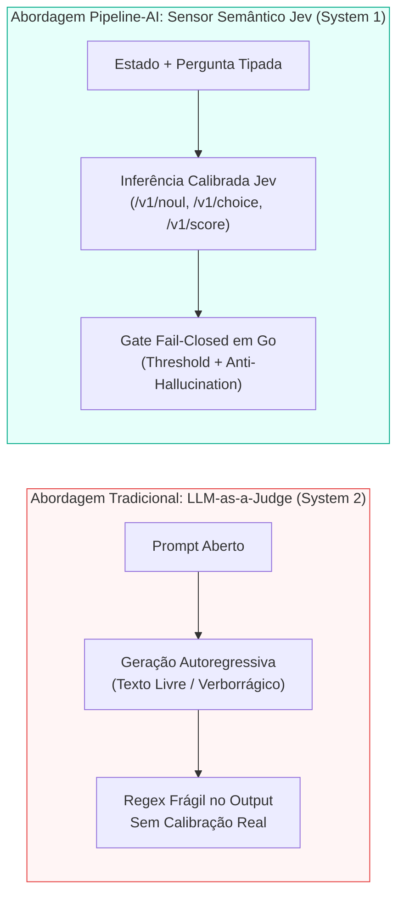
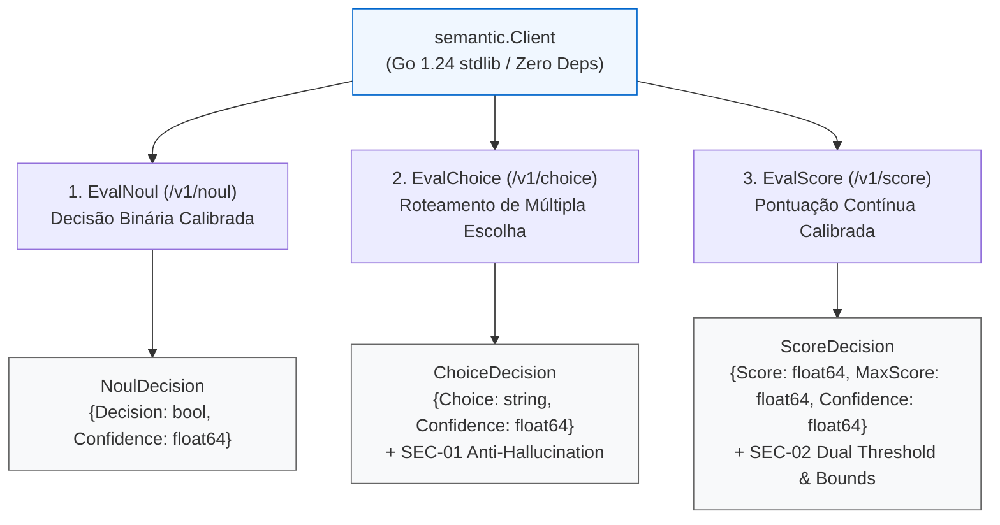

# System 1 vs. System 2 em Engenharia de IA: Como Substituímos Julgamentos Ambíguos de LLMs por Sensores Semânticos Calibrados (Jev) em Go Puro

*Por Rodrigo Oliveira — Engenheiro de Software & Pós-Graduando em Engenharia de IA Aplicada*

---

Na arquitetura de esteiras de engenharia assistidas por Inteligência Artificial, existe uma linha divisória clara entre o que os compiladores resolvem e o que exige compreensão semântica.

Para tudo o que é sintático e estrutural — formatação (`gofmt`), análise estática (`go vet`), execução de testes com detector de corrida (`go test -race`) e auditoria de vulnerabilidades (`govulncheck`) — nós já temos gates determinísticos perfeitos. Ou o código compila e passa nos testes, ou o gate barra a entrega com `exit code 1`.

Mas o que acontece quando uma decisão na esteira depende de **semântica**?
- *"Este diff altera alguma regra de autenticação ou superfície criptográfica?"*
- *"Qual skill especializada deve tratar este erro de migração SQL: `data-model`, `migration-reviewer` ou `dev-implementation`?"*
- *"Quão aderente aos invariantes arquiteturais do projeto está a justificativa deste handoff em uma escala de 0 a 10?"*

A resposta padrão da indústria nos últimos dois anos foi usar o padrão **"LLM-as-a-Judge"**: enviar um prompt gigante para um modelo generativo de raciocínio profundo (System 2) e pedir que ele responda "Sim ou Não" ou escolha uma opção em texto livre.

Em produção, porém, o "LLM-as-a-Judge" tradicional sofre de quatro patologias graves: **alta latência, verbosidade estocástica, ausência de calibração probabilística e alucinação de categorias**.

Neste artigo — consolidando as entregas **DEL-025, DEL-026, DEL-029 e DEL-030 (v0.10.0) do framework Pipeline-AI** —, apresento como aplicamos a teoria cognitiva de Daniel Kahneman (*System 1 vs. System 2*) à engenharia de agentes autônomos, construindo um **subsistema de sensoriamento semântico calibrado (Jev) em Go 1.24 puro (`internal/sensor/semantic`)**, com zero dependências externas, três primitivas de decisão tipadas (`EvalNoul`, `EvalChoice`, `EvalScore`), hardening de segurança *fail-closed*, blindagem com Fuzz Testing nativo e telemetria acoplada às métricas DORA.

---

## 1. Por que "LLM-as-a-Judge" (System 2) Falha em Esteiras Autônomas?

Em *Rápido e Devagar: Duas Formas de Pensar*, Daniel Kahneman descreve dois modos de operação cognitiva:
- **System 2 (Lento, Deliberativo, Generativo):** Analisa problemas complexos passo a passo, escreve código, projeta arquiteturas e redige relatórios. É onde brilham os modelos generativos de fronteira.
- **System 1 (Rápido, Classificatório, Calibrado):** Opera como um sensor reflexivo de baixíssima latência que classifica padrões, detecta anomalias e emite sinais de confiança calibrados.

Quando usamos um LLM generativo completo (System 2) como se fosse um sensor de gate na esteira de CI/CD ou de orquestração de agentes, encontramos armadilhas clássicas:



| Dimensão | LLM-as-a-Judge Tradicional (System 2) | Sensor Semântico Calibrado Jev (System 1 no Pipeline-AI) |
|---|---|---|
| **Natureza da Saída** | Texto livre generativo (*"Analisando o código, parece que sim..."*). | Estruturas estritas (`NoulDecision`, `ChoiceDecision`, `ScoreDecision`). |
| **Calibração de Confiança** | Ilusão de certeza (alucina "99% de certeza" no texto sem base nos logits). | Score de confiança calibrado (`Confidence` em `[0.0, 1.0]`) validado contra `Threshold`. |
| **Risco de Alucinação em Roteamento** | Inventa uma 4ª opção quando você pede para escolher entre 3 alternativas. | Trava `SEC-01` (*Anti-Hallucination*): rejeita com `ErrInvalidChoice` qualquer opção fora do conjunto permitido. |
| **Pontuação Numérica** | Retorna notas inconsistentes ou fora de escala sem garantia de fronteira. | Trava `SEC-02`: valida `[0.0, MaxScore]`, rejeita `NaN`/`Inf` e exige dupla aprovação (`Confidence` e `Score/MaxScore >= Threshold`). |
| **Comportamento em Falha** | Tenta adivinhar ou segue em frente silenciosamente (*fail-open*). | Estritamente **Fail-Closed**: se a confiança não atingir o threshold ou o servidor falhar, bloqueia a transição. |

---

## 2. As Três Primitivas de Decisão Semântica (`internal/sensor/semantic`)

Mantendo o invariante central do **Pipeline-AI** — **100% Go 1.24 standard library, zero dependências externas em `go.mod`** —, projetamos o pacote `internal/sensor/semantic` em torno de três primitivas complementares que cobrem todas as necessidades de julgamento de uma esteira autônoma:



### 2.1. `EvalNoul`: Decisão Binária Calibrada (`/v1/noul`)

A primitiva `EvalNoul` avalia uma hipótese binária sobre um estado (um trecho de código, um `git diff` ou um contrato de handoff) e retorna um `NoulDecision`:

```go
// internal/sensor/semantic/types.go
type NoulDecision struct {
    Decision   bool    `json:"decision"`
    Confidence float64 `json:"confidence"`
    Reason     string  `json:"reason,omitempty"`
}
```

Mesmo que o modelo responda `Decision: true`, se `Confidence` for `0.68` e o gate exigir `Threshold: 0.80`, `EvalNoul` retorna imediatamente `ErrInsufficientConfidence`. Incerteza estatística é tratada como reprovação segura.

### 2.2. `EvalChoice`: Roteamento de Múltipla Escolha com Trava Anti-Alucinação (`/v1/choice`)

Quando um orquestrador precisa classificar um incidente ou decidir para qual skill rotear uma demanda dentre um conjunto finito de opções, usamos `EvalChoice`.

Aqui implementamos a salvaguarda **`SEC-01` (Anti-Hallucination)**: o cliente exige ao menos 2 opções válidas na requisição e verifica deterministicamente se a opção retornada pelo modelo pertence de fato à lista fornecida:

```go
// internal/sensor/semantic/client.go
func (c *Client) EvalChoice(ctx context.Context, input ChoiceInput) (ChoiceDecision, error) {
    // Valida estado, pergunta e mínimo de 2 opções não vazias...
    data, err := c.doPost(ctx, "/v1/choice", payload)
    if err != nil {
        return ChoiceDecision{}, err
    }

    dec, err := ParseChoiceResponse(data)
    if err != nil {
        return ChoiceDecision{}, err
    }

    // SEC-01: Verifica se dec.Choice pertence estritamente a input.Choices
    validChoice := false
    for _, ch := range input.Choices {
        if dec.Choice == ch {
            validChoice = true
            break
        }
    }
    if !validChoice {
        return dec, fmt.Errorf("%w: escolha %q não pertence às opções permitidas", ErrInvalidChoice, dec.Choice)
    }

    if dec.Confidence < threshold {
        return dec, fmt.Errorf("%w: confiança %.2f abaixo do threshold %.2f",
            ErrInsufficientConfidence, dec.Confidence, threshold)
    }

    return dec, nil
}
```

Se o modelo tentar inventar uma opção fora do contrato, o sensor aborta imediatamente com `ErrInvalidChoice`.

### 2.3. `EvalScore`: Pontuação Contínua com Dupla Trava de Calibração (`/v1/score`)

Para avaliar qualidade contínua (como clareza de documentação, cobertura de requisitos ou severidade de risco em uma escala `0..MaxScore`), implementamos `EvalScore` com a salvaguarda **`SEC-02`**:

1. **Validação de Fronteiras Numéricas:** Rejeita `NaN`, `+Inf`, `-Inf`, valores negativos ou `Score > MaxScore` retornando `ErrInvalidScore`.
2. **Dupla Condição de Aprovação:** Não basta o modelo ter alta confiança de que a nota é baixa, nem dar uma nota alta com baixa confiança. `EvalScore` exige **simultaneamente**:
   - `Confidence >= Threshold`
   - `(Score / MaxScore) >= Threshold` (nota normalizada na escala `[0.0, 1.0]`)

```go
// internal/sensor/semantic/client.go
if dec.Score > maxScore {
    return dec, fmt.Errorf("%w: score %.2f excede max_score %.2f", ErrInvalidScore, dec.Score, maxScore)
}

if dec.Confidence < threshold {
    return dec, fmt.Errorf("%w: confiança %.2f abaixo do threshold %.2f",
        ErrInsufficientConfidence, dec.Confidence, threshold)
}

normalizedScore := dec.Score / maxScore
if normalizedScore < threshold {
    return dec, fmt.Errorf("%w: score normalizado %.2f (%.2f/%.2f) abaixo do threshold %.2f",
        ErrInsufficientConfidence, normalizedScore, dec.Score, maxScore, threshold)
}
```

---

## 3. Hardening de Segurança Fail-Closed (`SEC-01`, `SEC-02`, `SEC-03`)

Em um sistema onde agentes autônomos invocam ferramentas via linha de comando e protocolo MCP, o cliente HTTP semântico é uma superfície de segurança crítica. Centralizamos todo o transporte no helper privado `Client.doPost`, aplicando três barreiras inegociáveis:

1. **Redação Automática de Credenciais (`[REDACTED]`):** Qualquer erro de rede, DNS ou TLS passa pelo sanitizador `c.sanitizeError(err)`, que substitui ocorrências da `APIKey` (ou da variável `PIPELINE_AI_SEMANTIC_API_KEY`) por `[REDACTED]` antes de retornar o erro ao stdout, stderr ou payload JSON-RPC do MCP.
2. **Proteção contra Exaustão de Memória / DoS (`io.LimitReader`):**
   - Na entrada (CLI e MCP), o estado (`state`) é limitado estritamente a **512KB** (524.288 bytes) antes de abrir qualquer conexão de rede.
   - Na resposta HTTP, a leitura do body usa `io.LimitReader(resp.Body, maxBytes+1)` (padrão **10MB**), abortando com `ErrResponseTooLarge` caso um servidor anômalo tente enviar um stream infinito.
3. **Timeout Mandatório via Contexto:** Nenhuma chamada fica pendurada indefinidamente; `context.WithTimeout` (padrão de 10 segundos) cancela sockets lentos de forma determinística.

---

## 4. Blindagem com Fuzz Testing Nativo: Mais de 830.000 Execuções

Como os payloads JSON vêm de um serviço de inferência externo, nossos parsers `ParseNoulResponse`, `ParseChoiceResponse` e `ParseScoreResponse` foram submetidos ao motor de **Fuzzing nativo do Go** (`internal/sensor/semantic/fuzz_test.go`):

```go
// internal/sensor/semantic/fuzz_test.go
func FuzzParseScoreResponse(f *testing.F) {
    f.Add([]byte(`{"score":0.85,"max_score":1.0,"confidence":0.92,"reason":"ok"}`))
    f.Add([]byte(`{"score":-1.0,"max_score":10.0,"confidence":0.8}`))
    f.Add([]byte(`{"score":15.0,"max_score":10.0,"confidence":0.9}`))
    f.Add([]byte(`{}`))
    f.Add([]byte(`not json`))

    f.Fuzz(func(t *testing.T, data []byte) {
        dec, err := ParseScoreResponse(data)
        if err == nil {
            if dec.Confidence < 0.0 || dec.Confidence > 1.0 {
                t.Errorf("valid parse produced out-of-range confidence: %v", dec.Confidence)
            }
            if dec.Score < 0.0 || dec.MaxScore <= 0.0 || dec.Score > dec.MaxScore {
                t.Errorf("valid parse produced invalid score bounds: score=%v max=%v", dec.Score, dec.MaxScore)
            }
        }
    })
}
```

Executamos mais de **830.000 mutações aleatórias** combinadas entre `FuzzParseChoiceResponse` (421.119 execuções em 3s) e `FuzzParseScoreResponse` (410.163 execuções em 3s), comprovando **zero panics** e respeito absoluto às invariantes de domínio.

---

## 5. Ergonomia Dual (CLI + MCP) e Telemetria Semântica DORA

O sensor semântico foi desenhado para uso imediato tanto por humanos no terminal quanto por agentes via **Model Context Protocol (MCP)**:

### Na CLI (`pipeline-ai eval`):
```bash
# 1. Modo Binário (default -mode noul):
$ pipeline-ai eval -state internal/auth/token.go -question "os tokens são comparados em tempo constante?" -threshold 0.85

# 2. Modo Múltipla Escolha (-mode choice):
$ pipeline-ai eval -mode choice -state "erro SQL lock timeout" \
    -question "qual skill deve revisar?" \
    -choices "migration-reviewer,query-performance,code-reviewer"

# 3. Modo Pontuação Contínua (-mode score):
$ pipeline-ai eval -mode score -state docs-ai/deliveries/DEL-030/report.md \
    -question "completude das evidências de teste" -max-score 10 -threshold 0.8 -json
```

### No Servidor MCP (`pipeline_eval_semantic`):
Agentes conectados ao servidor MCP (`pipeline-ai mcp`) invocam `pipeline_eval_semantic` passando `mode` (`"noul"`, `"choice"`, `"score"`), `choices` e `max_score` diretamente via JSON-RPC 2.0 sobre `stdio`.

### Telemetria Semântica Integrada ao Motor DORA (`internal/metrics`):
Cada avaliação semântica executada registra passivamente um `SemanticEvalEvent` no banco de telemetria local (`.pipeline-state/metrics.json`). Quando consultamos `pipeline-ai metrics summary`, além das 4 métricas DORA, temos visibilidade completa da calibração do sensor:

```bash
$ pipeline-ai metrics summary
=== Métricas DORA & Telemetria (Últimos 30 dias) ===
...
Sensor Semântico (Jev):
  Total de Avaliações:           42
  Taxa de Aprovação:             88.1%
  Confiança Média:               91.4%
  Por Modo:                      noul=24, choice=10, score=8
```

---

## Conclusão: Orquestração Cognitiva Completa

A maturidade na Engenharia de IA não está em usar o maior modelo generativo para todas as tarefas, mas em **combinar a arquitetura certa para cada tipo de decisão**:

1. **Gates Determinísticos (`gofmt`, `go vet`, `go test -race`, `pipeline-validate`):** Verdade binária absoluta para sintaxe, compilação e invariantes estáticos.
2. **Sensores Semânticos Calibrados System 1 (`Jev` — `EvalNoul`, `EvalChoice`, `EvalScore`):** Classificação rápida, tipada, calibrada por threshold e protegida contra alucinações para decisões semânticas de roteamento e qualidade.
3. **Agentes Especializados System 2 (`architecture-guardrails`, `test-writer`, `dev-implementation`, `security-review`):** Raciocínio profundo focado onde a criatividade e a síntese de código são realmente necessárias.

---

O código completo do **Pipeline-AI (v0.10.0)** — incluindo o pacote `internal/sensor/semantic`, a CLI unificada, o servidor MCP nativo, o motor de métricas DORA e o Plugin Oficial do Google Antigravity — é 100% open-source sob licença MIT:

👉 **Repositório Oficial:** [github.com/rodrigodosanjosoliveira/pipeline-ai](https://github.com/rodrigodosanjosoliveira/pipeline-ai)

Como você tem lidado com decisões semânticas e roteamento de agentes nas suas esteiras de IA? Já enfrentou problemas de inconsistência com o padrão *LLM-as-a-Judge*? Vamos conversar nos comentários! 💬🧠🚀
